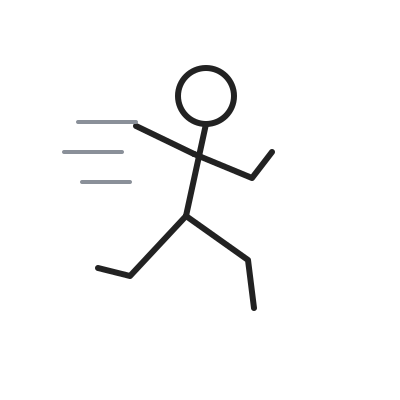

# AIGC 简笔画工坊

> 描述一句话，生成可直接下载的 SVG 简笔画 / 火柴人。
> A tiny, serverless doodle studio: describe it in one sentence, get a clean SVG.


**在线 Demo**：<https://1576584678.github.io/aigc-doodle-studio/>（首次 Pages 部署完成后可用）
**源码**：<https://github.com/1576584678/aigc-doodle-studio>

<table>
  <tr>
    <td align="center"><br><sub>简笔画模式 · 内置示例</sub></td>
    <td align="center"><br><sub>火柴人模式 · 内置示例</sub></td>
  </tr>
</table>

<sub>上方为仓库内置的原创 SVG 示例作品，非模型实时生成结果。</sub>

---

## 它是什么

一个**纯静态前端**小工具：浏览器直接调用你自己配置的 OpenAI 兼容 `chat/completions` 端点，让模型输出一段 SVG，前端清洗后渲染到画布，可下载、导出 PNG、生成分享图、打印或存进本地画廊。

| 关键事实 | 说明 |
|---|---|
| 没有服务器 | 静态 HTML/CSS/JS，可托管在任意静态站点 |
| 没有账号 | 不注册、不登录、不收集任何个人信息 |
| 不收费 | 本站不收费；模型调用费用由你与所选服务商结算 |
| Bring Your Own Key | API Key、Base URL、Model 由你填写，只保存在本机浏览器 |
| 零运行时依赖 | 仅 TypeScript + Vite 构建，产物不含第三方运行时库 |

> 配置提示：因为是浏览器直连，你填写的端点需要是 **HTTPS** 且**允许跨域（CORS）**。纯前端站点无法代为转发请求。若端点不满足这两个条件，生成会失败——这是架构选择带来的已知约束，不是 bug。

---

## v0.3 能做什么

**不填任何 Key 也能用**：首屏直接展示 6 张内置示例作品，可点开、下载、导出 PNG、生成分享卡片、打印。模型配置默认收起，只在你想自己生成时才展开。

| 场景 | 能力 | 是否需要 Key |
|---|---|---|
| 看看效果 | 6 张内置示例（3 简笔画 + 3 火柴人），带「示例」角标，与生成结果明确区分 | 否 |
| 带走作品 | 下载 SVG / 导出 PNG（透明底·白底 × 1x/2x/4x）/ 复制代码 / 生成 1080×1440 分享图 / A4 打印为 PDF | 否 |
| 自己生成 | 端点预设 + 连接自检（CORS / 401 / 404 / 429 / 超时分类提示）+ 模式 + 3 档画风 | 是 |
| 不丢作品 | 画布历史最近 5 张（仅本次会话）、存入画廊 50 张、删除后 5 秒可撤销并恢复原位置 | 否 |
| 自己掌控数据 | 「本次不保存 Key」勾选 + 一键清除本机数据（二次确认、不可恢复） | 否 |

所有导出与分享都在本机 Canvas 合成，**不产生除你填写的端点之外的任何网络请求**。

---

## 为什么值得看代码

这类「让大模型吐 SVG」的 demo 常见，本项目把力气花在了**不可信模型输出进入 DOM 之前**、以及**纯前端下的状态完整性**上。

**1. SVG 白名单安全过滤**（`src/sanitize.ts`）

模型输出是不可信输入，直接 `innerHTML` 等于把 XSS 入口敞开。这里用 DOMParser 解析为 XML 文档后做「元素白名单 + 属性白名单 + 显式黑名单」双保险：

- 只保留 `svg/g/path/line/circle/rect/ellipse/polyline/polygon/text/tspan/title/desc`，非白名单元素**连同整棵子树**删除；
- 显式封禁 `script / foreignObject / image / style / animate / use / a / iframe / filter / mask / pattern / defs / set` 等向量；
- 所有 `on*` 事件属性删除；属性值经去空白与控制字符的 `squash` 处理后拦截 `javascript:` / `data:` / `vbscript:` / `expression(` 以及外部 `url(http…)` 引用，抵御 `java\tscript:` 类混淆，同时保留本地 `url(#id)`；
- 拒绝 `DOCTYPE` / `ENTITY`（防实体展开），CDATA 降级为普通文本节点，注释与处理指令移除；
- 强制补全合法 `xmlns`，序列化后再校验根节点与命名空间。

过滤执行**三次**：生成侧（`api.ts`）、画布渲染侧（`work.ts`）、画廊读取侧（`main.ts`），外加示例作品加载侧。第三处用于防「localStorage 被篡改后的存储型 XSS」。下载、复制、导出、分享出去的 SVG 都来自过滤后的同一份字符串。`tests/sanitize-vectors.mjs` 提供 38 条攻击向量与合法样本的回归集。

**2. 生成状态机**（`src/main.ts`）

`idle → generating → cancelling / success / error` 五态。要点：`AbortController` 取消、**分段超时**（单次 45s、重试独立计时、总上限 90s）、网络错误/5xx 单次重试、取消期间任何 `resolve` 一律丢弃（不渲染、不报成功）、error 态保留上一张成功图且不变红、`finally` 统一清理计时器与 DOM 状态、焦点不丢失。连接自检是**独立子状态机**，不读写主状态机，避免两个 `AbortController` 串扰。

**3. 本地画廊与可撤销删除**（`src/gallery.ts` / `src/undo.ts`）

读取时清洗脏数据（非数组、缺 id/svg、字段类型异常一律丢弃），并对 v0.2 遗留的无 `style` 数据做向后兼容；满 50 张时**前置拒绝，不静默删除旧作品**；`QuotaExceededError` 与「浏览器禁止存储」分开分类；删除后 5 秒可撤销，恢复原 `id` / `ts` / 原索引，窗口由 `setTimeout` 驱动（不用 `animationend`，否则 reduced-motion 下撤销权会瞬间失效）。

**4. 无障碍与状态完整性**

`prefers-reduced-motion`、`:focus-visible` 焦点环、44px 触屏点击目标、760px 响应式、空/加载/错误/边界四态。移动端为了「陌生访客首屏先见示例」，采用**按已有 Key 分流 + `insertBefore` 物理 DOM 重排**，而不是 CSS `order`——保证 DOM 序 = 视觉序 = Tab 序 = 读屏线性序。播报遵循单一来源：删除只写 toast、自检只写自身结果区、计数不参与 live 播报。

**5. 零依赖回归测试**

`npm test` 跑纯 Node 静态门禁（向量条数、覆盖关键词、违禁词、运行时依赖、示例体积）；`npm run test:browser` 用系统无头浏览器跑两页真实断言：`tests/sanitize.test.html`（38 条 SVG 白名单回归）与 `tests/interaction.test.html`（44 条真实应用交互：示例墙、历史、无配置引导、PNG 透明底 2x 与白底 4x 的字节/尺寸/alpha、分享卡片、删除撤销恢复原索引、清除事务、打印、自检错误分类）。合计 **82 条通过 / 0 失败**，1 项因「站点地址是 Canvas 像素文本而非 DOM 节点」如实跳过。两层都不引入任何 npm 依赖或第三方脚本，静态门禁已串入 `npm run build` 前置。

---

## 快速开始

```bash
git clone https://github.com/1576584678/aigc-doodle-studio.git
cd aigc-doodle-studio
npm install
npm run dev          # http://localhost:5173
```

构建、测试与本地预览：

```bash
npm run build        # verify 静态门禁 → tsc --noEmit → vite build，产物在 dist/
npm test             # 静态门禁（向量 / 违禁词 / 依赖 / 示例体积）
npm run test:browser # 真实浏览器断言（无可用浏览器时明确跳过）
npm run preview
```

部署到 GitHub Pages 项目页时需要指定 base（本仓库的 Actions 工作流已自动设置该环境变量）：

```bash
VITE_BASE=/aigc-doodle-studio/ npm run build
```

**使用步骤**：打开首页即可点开 6 张示例 → 下载 SVG / 导出 PNG / 复制代码 / 生成分享图 / 打印；若要用自己的模型生成，展开「模型设置」→ 填 Base URL / API Key / Model → 点「测试连接」→ 选模式与画风 → 写一句描述 → 生成 → 存入画廊。`Ctrl / ⌘ + Enter` 可快速提交。

> ⚠️ API Key 以**明文**存在浏览器 `localStorage`，页面已就该风险给出提示。公用电脑请勾选「本次不保存 Key」，用后可在设置区「清除本机数据」一键清空。请勿把真实 Key 写进 issue、截图或提交记录。

---

## 目录结构

```
├── index.html              # 页面结构与全部静态文案
├── src/
│   ├── main.ts             # 五态状态机与模块编排（唯一入口）
│   ├── api.ts              # OpenAI 兼容端点调用、SVG 抽取、错误契约与自检
│   ├── sanitize.ts         # SVG 白名单安全过滤（核心）
│   ├── gallery.ts          # localStorage 画廊读写、清洗、撤销恢复
│   ├── prompts.ts          # 两种模式 + 3 档画风的 system prompt
│   ├── samples.ts          # 6 张内置原创示例 SVG
│   ├── work.ts / ui.ts / dom.ts / types.ts   # 画布状态、状态与 toast、DOM 引用、类型
│   ├── export.ts / sharecard.ts / print.ts   # PNG 导出、分享卡片、A4 打印
│   ├── history.ts / undo.ts / clear.ts       # 会话历史、删除撤销、清除本机数据
│   ├── selftest.ts / styles.ts / layout.ts / telemetry.ts  # 连接自检、画风、栏序、匿名事件名
│   └── style.css           # 设计令牌、响应式、打印样式、无障碍
├── docs/
│   ├── PRD-v0.3.md         # v0.3 完整产品需求文档
│   ├── design/             # 视觉规范 visual-spec.md 与体验规范 ux-spec.md
│   └── preview/            # README 用的原创示例 SVG
├── tests/                  # 攻击向量、浏览器断言页
├── scripts/                # 零依赖静态门禁与浏览器测试启动器
├── .github/workflows/      # Pages 部署
└── vite.config.ts
```

---

## 路线图

当前为 **v0.3**。完整范围、验收标准与风险登记见 [`docs/PRD-v0.3.md`](docs/PRD-v0.3.md)，界面与交互依据见 [`docs/design/`](docs/design/)。

| 优先级 | 内容 | 状态 |
|---|---|---|
| P0 | 免配置示例作品（无 Key 也能看、能导出） | 已实现 |
| P0 | PNG 导出（透明底 / 白底，1x/2x/4x） | 已实现 |
| P0 | 端点预设与连接自检（六类错误分类） | 已实现 |
| P1 | 画布历史（最近 5 张，仅内存） | 已实现 |
| P1 | 删除 5 秒撤销、清除本机数据、作品分享卡片 | 已实现 |
| P1 | 分段超时修复、`sanitize.ts` 38 条回归向量 | 已实现 |
| P2 | 风格选择器、A4 打印、平台侧匿名事件名 | 已实现 |

**当前已知限制**：

- 不填 Key 只能浏览与导出内置示例，不能调用模型生成；浏览器直连要求端点为 HTTPS 且允许 CORS，本站不代为转发。
- 分享回流、留存率、用户级去重在无后端无账号下不可测；平台侧统计不可用时只保留访问量，本站不伪造数据。
- 画廊与历史都在本机，清浏览器数据或换设备即不可见；历史仅本次会话有效。
- A4 打印本期只支持单图，暂不提供多图拼版。

---

## 参与贡献

欢迎提 Issue 与 PR，见 [`CONTRIBUTING.md`](CONTRIBUTING.md)。发现安全漏洞请走 [`SECURITY.md`](SECURITY.md) 的私下披露路径，不要公开提 Issue。

如果这个项目对你有参考价值，欢迎点一个 ⭐ Star —— 这是对我继续维护它的反馈。本项目不会以任何奖励换取 Star，也不会在产品内做求 Star 的弹窗或功能门槛。

## 许可

[MIT](LICENSE) © 2026 Li Yuelin

## 声明

本项目为独立开发的开源作品。文中提到的模型服务均为用户自行选择的第三方服务，与本项目无关联，本项目不对其可用性、费用或合规性作任何承诺。README 中的示例数据均为原创或虚构。
