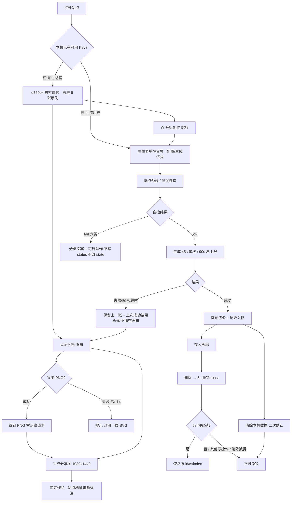

# AIGC 简笔画工坊 v0.3 · 体验设计规范（UX Spec）

| 项 | 内容 |
|---|---|
| 文档版本 | v1.0（Phase 2 交付） |
| 对应产品版本 | v0.3（代码基线 v0.2，提交 `13cc02d`） |
| 上游依据 | `docs/PRD-v0.3.md`（第四章 / 第七章 FR-01~FR-14 / 第八章 NFR / 第九章状态机 / 第十章埋点 / 第十一章 SEC / 第十二章异常清单 / 附录 A、B、D、E）、`docs/design/visual-spec.md`（Phase 1，695 行） |
| 代码基线 | `index.html`、`src/main.ts`（五态状态机）、`src/style.css`（760px 断点 / `:focus-visible` / reduced-motion / toast） |
| 作者 | 体验设计专家（信息架构 / 交互流程 / 响应式 / 无障碍） |
| 读者 | team-lead、Phase 3 前端工程师、测试、合规确认人 |
| 下游 | Phase 3 前端落地、Phase 4 汇编验证 |

> **交付边界**：本文档只定义信息架构、交互流程、状态/事件、无障碍与响应式验收口径。作者**未修改、也不得修改** `index.html`、`src/**/*.ts`、`src/style.css`、`docs/design/visual-spec.md`、`docs/PRD-v0.3.md`；本次仅新增本文件。所有 CSS / DOM / TS 落地由 Phase 3 执行。
>
> **不推翻的锁定项**：visual-spec §2 色值、§7 类名清单、§8 禁止项 16 条、§3 标尺、§6 分享卡片坐标全部原样继承。本文档若需调整，均在 §8 「否决 / 修正」中逐条注明理由；调整仅限**交互行为与最小 DOM 结构**，不涉及色值与既有类名语义。
>
> **硬约束（全篇适用）**：不引入后端 / 账号 / 云同步；不引入第三方统计 SDK、外链脚本、远程字体；不引入任何 npm 运行时依赖；不改 PRD 附录 B 信息架构、NFR-08、第十二章 19 条异常清单（见附录 A/B/C 逐条对齐）；本站统一表述「**本站不收费**」，禁止「完全免费 / 零成本 / 无限免费生成」与绝对化用语。
>
> **读法**：§1 是三个开放问题的裁决（可直接验收）；§2/§3 给主理人与测试看；§4/§5/§6 给 Phase 3 与测试看；§7 是风险台账；§8/§9 是给 Phase 3 的落地清单。用例编号 `UX-*` 为体验侧新增用例，与 PRD 附录 A 的 `TC-xx` 槽位并行，不覆盖、不改写。

---

## 0. 核心结论先行（给赶时间的人）

| # | 结论 |
|---|---|
| 1 | **移动端栏序：折中采纳。** 采纳「≤760px 陌生访客首屏先见 6 张示例」这一目标；**否决** visual-spec §5.1 的无条件 `.right{order:-1}`（仅改视觉序、不改 DOM/Tab 序，违反 WCAG 1.3.2 / 2.4.3；且把回流用户的表单推到示例墙 + 历史 + 画廊之后）。替代手段：按 `localStorage` 是否已有可用 Key 分流 + **物理 DOM 重排**（不是 CSS `order`）+ 顶部费用/隐私摘要行 + 「开始创作」跳转。 |
| 2 | **浮层与弹窗：分层裁决。** 导出面板 = 非模态（ESC 关、点外部关、无焦点陷阱、焦点落点留在触发按钮、关闭归还触发按钮）；`<dialog>` 二次确认 = 模态（ESC=取消、点 `::backdrop` **不关**、原生焦点陷阱、**默认焦点必须落在「取消」**、关闭归还 `.link-danger`）。逐条用例见 §1.2。 |
| 3 | **状态四态与撤销 toast：单一播报源。** 删除动作只由 toast 播报一次、不再写 `#status`；`#gallery-count` 去掉 `aria-live`；进度条为纯视觉 `width` 动画，**5 秒窗口必须由 `setTimeout` 驱动，禁止用 `animationend`**（否则 reduced-motion 全局 `.01ms` 会把撤销窗口瞬间结束）；5 秒内不更新任何 live 区域文本；「上次成功结果」角标在示例作品上不显示、离开 `error` 态即移除；error 态画布不清空、边框不变红。 |
| 4 | **不新增任何持久化状态。** 栏序分流只读 v0.2 已有的 `aigc_doodle_settings.apiKey`（内存读取、不写入、不外发、不进统计）；导出选项「本地记住」仅内存；「记住设置区收起态」（FR-01 规则 5 的 `may`）体验侧**主动选择不做**。 |
| 5 | 给 Phase 3 的 8 条关键约束见 §9.0；完整 28 条见 §9.1。前端最容易出错的 3 个点见 §7.0（并在交接消息中复述）。 |

---

## 1. 裁决：Phase 1 留给体验侧的三个开放问题

### 1.1 开放问题 1 · 移动端栏序（≤760px）

#### 1.1.1 两条路径评估

| 维度 | 路径 A：陌生访客（无 Key）「先体验」 | 路径 B：回流用户（已存 Key）「先配置」 |
|---|---|---|
| 第一任务 | 看到 6 张示例 → 点开 → 导出 PNG / 生成分享图（M-01、FR-01、US-01） | 校验配置 → 直接生成 → 存画廊（US-02、分支 A） |
| 首屏必须出现 | 6 张示例格 +「示例」角标 + 费用说明（FR-01 验收：1 秒内、零报错文案） | 描述框 / 模式 / 生成按钮（或至少一键可达） |
| 若左栏在前 | 左栏 ≈ 500px（价值卡 + 设置 + 模式 + 风格 + chips + 描述 + 生成 + status）把示例墙推到首屏之外，**M-01 / FR-01 不成立** | 符合预期，表单即首屏 |
| 若无条件右栏在前（`.right{order:-1}`） | 几何上达标；但产生 3 个新问题（下） | **受损**：表单被推到示例墙 + 历史条 + 6 个操作按钮 + 画廊之后，回流用户要长距离滚动才能生成 |
| 无条件 `order:-1` 的三个问题 | ① **焦点/阅读顺序倒挂**：CSS `order` 只改视觉序，DOM 与 Tab 序仍是 `left → right`，键盘与读屏用户先遍历整张表单才到达视觉上置顶的示例，违反 WCAG 1.3.2「有意义的顺序」/ 2.4.3「焦点顺序」，也违反 NFR-08「新增按钮均键盘可达」的实操预期；② 费用/隐私说明（`.value-card` 在左栏）被推到第二屏，与 FR-01 规则 5「不得因此隐藏费用说明」精神冲突；③ 回流用户路径受损（上表右列） | 同左 |

#### 1.1.2 明确结论：**折中采纳**

- **采纳**：≤760px 且本机无可用 Key 时，产出区（右栏）置顶，陌生访客首屏 1 秒内可见 6 张示例。
- **否决**：visual-spec §5.1 的**实现手段** `.right{order:-1}`（无条件、纯 CSS）。视觉结果不变，**实现手段替换**为「DOM 同步重排」。
- **折中机制（三条同时生效）**：
  1. **分流判定**：初始化时读取 `loadSettings()` 已填入内存的 `apiKey`：`trim() !== ''` → 判定为「回流用户」，**不重排**（DOM 保持 `left → right`，表单在首屏，符合「先配置」）；`trim() === ''` → 判定为「陌生访客」，**重排**为 `right → left`。刷新后重新判定。
  2. **DOM/焦点一致**：重排必须用 `layout.insertBefore(rightEl, leftEl)` 物理移动节点，**不得**只用 CSS `order`；桌面（>760px）始终 `left → right`，用现有 `grid-template-columns:360px 1fr` 自然落位，无任何 `order` 声明。跨断点 resize 时重新同步顺序并**恢复焦点**（见 §9.1 C-04），使任何断点下 **DOM 序 = 视觉序 = Tab 序 = 读屏线性序**。
  3. **费用说明首屏兜底**：右栏首行新增 `.mobile-lead`（仅 ≤760px 可见，`--fs-12` / `--info-text`，C-04 5.4:1），常驻文案「本站不收费 · 模型与 API Key 由你自备 · 数据仅存本机」，合并 visual-spec §5.1 建议的引导语，并带一个 ≥44px 的 `.lead-jump` 按钮「开始创作」（点击展开/滚动到左栏并聚焦 `#prompt`）。该行保证设置区收起、价值卡落到第二屏时，FR-02 / FR-01 规则 5 的费用说明仍在首屏可见；页脚 `.footer` 常驻说明保持不动。

> 对 visual-spec §5.1 引导行的**修正**：原建议「先看看示例，滑到下方开始创作」只有引导、无费用说明、无可操作跳转；本规范把它升级为「费用/隐私摘要 + 可键盘操作的跳转按钮」。理由：FR-01 规则 5 + FR-02 + 避免用户被示例墙「困住」。见 §8。

#### 1.1.3 可验收判定口径（UX-M-\*）

| 用例 | Given | When | Then（判据） |
|---|---|---|---|
| UX-M-01 | 全新会话（清空 `localStorage`）、375×667 CSS 视口、折叠浏览器工具栏后可视为 ≥600px | 打开首页不滚动 | 6 个 `.sample-tile` 与 6 个「示例」角标全部在首屏可见；页面无 `.status.error`；网络面板模型请求数 = 0；DOM 中 `.right` 位于 `.left` 之前 |
| UX-M-02 | 同上 | 从地址栏按 Tab 依次聚焦 | 焦点序列 = 视觉序列：`.lead-jump` → 6 个 `.sample-tile` → 历史/操作条 → 画廊 → `.value-card`/`.settings-head`/表单 → 页脚；**不出现**「焦点先跳到视觉下方的表单、再跳回视觉上方示例」的倒挂 |
| UX-M-03 | 预置 `aigc_doodle_settings` 含非空 `apiKey`、375px | 打开首页 | **不重排**（DOM `left → right`）；`#prompt` 与 `#generate` 在首屏可见且可聚焦；`syncMobileOrder()` 判定为回流用户 |
| UX-M-04 | 1200×800 桌面、任意 Key 状态 | 打开首页 | 两栏 `360px 1fr`；DOM `left → right`；无 `order` 声明；Tab 序与视觉序一致；`.mobile-lead` 不可见（`display:none`） |
| UX-M-05 | 375px 无 Key（已重排） | 点 `.lead-jump` | 左栏表单进入视口、`#prompt` 获得焦点、`promptEl.scrollIntoView` 生效；reduced-motion 下 `behavior:'auto'`；费用摘要仍可见 |
| UX-M-06 | 375px 已重排 | 执行 FR-13「清除本机数据」并确认 | 重排判定重新执行（Key 已空）→ 保持 `right → left`；`.mobile-lead` 与费用说明仍可见；焦点归还 `.link-danger` |
| UX-M-07 | 375px 无 Key，勾选「本次不保存 Key」后曾填入 Key 并刷新 | 刷新 | localStorage 无 Key → 判定为陌生访客 → 保持重排；**不写入任何新键**；属预期降级（隐私优先） |
| UX-M-08 | 375px 无 Key → resize 到 1200px → 再回 375px | 每次断点变化后 | 顺序同步正确；若变化前焦点在页面内，变化后 `document.activeElement` 仍为原元素（或显式恢复到等价控件），焦点**不落到 `body`**；无横向滚动 |
| UX-M-09 | 任意会话、任意断点 | 全文检索新增界面 | 不含「完全免费 / 零成本 / 无限免费生成 / 最 / 第一 / 顶级」；`lead` 行、价值卡、页脚均含「本站不收费」口径 |

#### 1.1.4 是否引入持久化状态 / 对隐私与首屏性能的影响（显式回答）

| 项 | 结论 |
|---|---|
| **持久化状态** | **不新增任何 localStorage 键**。不写 `hasVisited` / `layoutPref` / `lastPane` / 收起态记忆；分流只读 v0.2 既有 `aigc_doodle_settings.apiKey`（`loadSettings()` 已把值放入内存输入框，判定为 O(1) 字符串 `trim()`）。FR-01 规则 5 允许的「记住上次收起态」是 `may`，体验侧**明确选择不做**，理由：为零收益引入一个可被第三方脚本枚举的键，与零采集卖点不符。导出面板底色/倍率「本地记住」同样**仅内存、不落盘**。 |
| **隐私** | 只读、不写、不外发；Key 不进入 URL / 日志 / `console` / 统计事件 / 分享卡片 / 打印稿（SEC-03 / SEC-06 / FR-08）；不新增第三方脚本；判定结果不落盘、不随页面状态外泄。`SEC-04 本次不保存 Key` 下刷新按「无 Key」处理，属隐私优先的预期降级（UX-M-07）。 |
| **首屏性能** | 判定发生在模块初始化、`loadSettings()` 之后、任何 DOM 注入之前；**无额外 localStorage 读取、无网络、无重排抖动**：示例墙本就由 JS 在初始化时构建，`insertBefore` 先于构建完成，不构成可见闪烁。复杂度 O(1)，对 NFR-01「首屏可交互 ≤2s / 示例 1s 内可见」无影响。`matchMedia` 监听器只在断点跨越时触发，不监听 `scroll`/`resize` 每一帧。 |
| **降级方案** | 若 Phase 3 判定 DOM 重排风险过高，允许退到「顶部折叠输入摘要」备选（把左栏表单收进原生 `
`，默认收起、`#status` 留在外部常驻），同样保持 DOM 序不变；但**不得**退回纯 CSS `order:-1`。该备选须在交付说明中记录，且仍需通过 UX-M-01/02/09。 |

---

### 1.2 开放问题 2 · 浮层与弹窗交互验收（逐条可测用例）

#### 1.2.1 决策矩阵

| 行为 | `.export-panel`（导出面板，非模态） | `.confirm-dialog`（FR-13 二次确认，原生 `<dialog showModal()>`，模态） |
|---|---|---|
| ESC 关闭 | **可关**。`aria-expanded=false`、`hidden`、焦点归还触发按钮 | **可关，语义 = 取消**（原生 `cancel` → `close`）。数据零变更、撤销窗口不终止 |
| 点击外部关闭 | **可关**（点面板外空白 / 其他 `.act-btn`）；点触发按钮本身或面板内部**不关** | **不可关**。禁止给 `::backdrop` 绑定任何 `click` 关闭逻辑；必须显式点「取消」或「确认清除」 |
| 打开时焦点落点 | **留在触发按钮**（不抢焦点）；面板 DOM 紧跟触发按钮，Tab 自然进入第一个 `.export-opt` | **必须落在「取消」`.btn-quiet`**（`showModal()` 后显式 `.focus()`，或用 `autofocus`）；**禁止**默认落在 `.btn-danger`；标题 `h2` 不得设 `autofocus` |
| 关闭后焦点归还 | 若焦点在面板内 → 归还 `[data-action="export-png"]`；若一直在触发按钮 → 保持 | 关闭（取消 / ESC / 确认）后归还 `.link-danger`；触发按钮已断开时降级到 `.settings-head` |
| 焦点陷阱 | **不设**（非模态，用户可 Tab 离开面板到页面其他控件；背景不 `inert`） | **设**（`showModal()` 自带 top-layer 陷阱）；Tab / Shift+Tab 只在弹窗内循环，背景控件 `inert` |
| 叠加 | 打开 `<dialog>` 前必须先关闭导出面板 | 禁止二次弹窗叠加（visual-spec §8 #16）；弹窗打开期间 `.toast-undo` 位于遮罩下且被 inert，不可聚焦 |
| 默认安全 | 选项无破坏性，可本地内存记住 | 危险操作安全默认：焦点在「取消」，确认需显式 Enter/Space |

> **命名约定**：导出触发按钮全文统一以属性选择器 `[data-action="export-png"]` 引用（不新增 ID、不新增类名，符合 visual-spec §7）；文中「触发按钮」「导出触发元素」均指它。所有焦点归还断言用 `document.querySelector('[data-action="export-png"]')` 取值。

#### 1.2.2 逐条可测用例（UX-O-\*）

| 用例 | 触发 / Given | 期望（可断言） |
|---|---|---|
| UX-O-01 | 点击 / Enter / Space 触发「导出 PNG」 | `.export-panel[hidden]` 移除 → `hidden=false`；触发按钮 `aria-expanded=true`；`document.activeElement` 等于 `[data-action="export-png"]`；面板 DOM 位置紧随该按钮所在 `.act-wrap` |
| UX-O-02 | 触发按钮已聚焦，按 Tab ×4 | 焦点依次到底色组第 1 项 → 底色组第 2 项 → 倍率组 → `.export-go`；Shift+Tab 可逆向回到触发按钮；每步焦点环可见（全局 `:focus-visible`） |
| UX-O-03 | 导出面板打开、焦点在触发按钮，按 Esc | 面板 `hidden=true`、`aria-expanded=false`；焦点仍在 `[data-action="export-png"]`；无其他状态变化 |
| UX-O-04 | 导出面板打开、焦点在 `.export-opt`，按 Esc | 面板关闭；焦点**归还** `[data-action="export-png"]`；选项 `is-active` 保留（内存记忆） |
| UX-O-05 | 导出面板打开，点击面板外空白处 / 其他 `.act-btn` | 面板关闭并归还焦点；点击其他 `.act-btn` 时该按钮自身动作照常执行，不出现「关了又开」闪烁 |
| UX-O-06 | 导出面板打开，点击面板内部、点击触发按钮本身 | 点内部：不关闭；点触发按钮：toggle 关闭（一次点击一次切换），不重复触发打开 |
| UX-O-07 | 导出面板打开，连续按 Tab 10 次 | 焦点可离开面板进入页面其他控件（**无陷阱**）；背景控件未被 `inert`；无焦点丢失到 `body` |
| UX-O-08 | 选「透明底 2x」→ 关闭 → 再次打开 | 两选项仍为 `.is-active`（内存记忆，不写 localStorage）；`.export-meta` 显示「透明底 2x = 800 × 800」 |
| UX-O-09 | 点 `.export-go`，导出进行中连续点 3 次 | `.export-go.is-busy`、`aria-busy=true`、`cursor:progress`；仅执行 1 次导出；按钮盒模型尺寸不变 |
| UX-O-10 | 模拟 Canvas 抛错（EX-14） | 面板**保持打开**；面板内出现 `.status.error`「PNG 导出失败，可改用下载 SVG」；焦点移到该错误容器（`tabindex="-1"`，只播报一次）；主操作条「下载 SVG」仍 enabled；Esc 可关闭并归还焦点 |
| UX-O-11 | 导出面板打开时点「清除本机数据」 | `showModal()` 前导出面板已 `hidden=true`；页面不出现两层浮层；`<dialog>` 在 top layer |
| UX-O-12 | 点 `.link-danger` 打开弹窗 | `dialog.open === true`；`document.activeElement === .btn-quiet`（取消）；`aria-labelledby` 指向 `.confirm-title`、`aria-describedby` 指向 `.confirm-desc`/`.confirm-list`；三类清单可读 |
| UX-O-13 | 弹窗打开后 Tab ×10 / Shift+Tab ×10 | 焦点始终在 `.confirm-dialog` 内循环（`.btn-quiet` ⇄ `.btn-danger`）；`document.activeElement` 永不在背景；`.toast-undo` 不可聚焦 |
| UX-O-14 | 弹窗打开，点击 `::backdrop` 区域 | 弹窗**不关闭**；数据零变更；控制台无 `close` 事件 |
| UX-O-15 | 弹窗打开，按 Esc | 弹窗关闭（`cancel` 未被 `preventDefault`）；两份 localStorage 键与内存态不变；**未结束的撤销 toast 仍在且可用**；焦点归还 `.link-danger` |
| UX-O-16 | 点「取消」/ 点「确认清除」 | 弹窗关闭；焦点归还 `.link-danger`（断开时降级 `.settings-head`）；取消：数据不变；确认：执行 §4.6 全部动作 |
| UX-O-17 | 弹窗打开时按 Esc，同时导出面板曾处于打开态 | 全局 keydown 处理器首行 `if (dialog.open) return`，**不**误关 / 误开导出面板；Esc 只由原生 dialog 消费一次 |
| UX-O-18 | 分别对 `.export-go`、`.btn-danger`、`.toast-undo` 用 **Tab**（非鼠标）聚焦 | `getComputedStyle` 命中 visual-spec §2.4：`outline:2px solid rgb(255,255,255)` + `outline-offset:-5px` + `box-shadow` 含 `0 0 0 2px` 蓝环（`--focus-ring`）；内白环在深底 ≥6.3:1、外蓝环在白页 ≥3:1；三个元素均**无** `outline:none` |
| UX-O-19 | 对上述三个元素用**鼠标**点击 | 不出现焦点环（`:focus-visible` 语义正确）；键盘 Tab 时环出现 |
| UX-O-20 | 系统开启 `forced-colors: active` / Windows 高对比 | 深色填充按钮 `outline:2px solid Highlight; outline-offset:-5px; box-shadow:none` 兜底可见（见 §8 修正 4，不改任何已锁定色值） |
| UX-O-21 | 撤销 toast 可见时打开弹窗 → 点「取消」 | 关闭后 `.toast-undo` 恢复可聚焦，撤销窗口剩余时间继续有效；焦点归还 `.link-danger` 后可 Tab 到撤销按钮 |

#### 1.2.3 visual-spec §2.4「内白环 + 外蓝环」键盘走查方式（标准步骤）

1. 桌面 1200px，只用键盘（不碰鼠标）；`Tab` 到「导出 PNG」→ `Enter` 打开面板 → `Tab` 到 `.export-go` → **截图 + 读取计算样式**，核对 UX-O-18。
2. `Esc` 关面板 → `Tab` 到「清除本机数据」→ `Enter` 打开弹窗 → 断言焦点在「取消」→ `Tab` 到 `.btn-danger` → 截图核对内白环未被文字压住（`outline-offset:-5px` 内嵌）、外蓝环落在白色页面而非深底。
3. 关闭弹窗 → 删除一张画廊作品 → `Tab` 到 `.toast-undo` → 核对深底 toast 上的双环；核对环未被 `.toast{overflow:hidden}` 裁掉（`.toast.is-undo` 的 `padding` 与 `pointer-events` 须留环空间）。
4. `Shift+Tab` 逆向走查一遍；再用鼠标点击三个按钮，确认「点击无环、Tab 有环」。
5. 切到 375px 重走 1~3（底部面板形态、toast 全宽），确认环不被 `left:12px;right:12px` 裁切。
6. 打开系统高对比模式重走 1~3，确认 UX-O-20 兜底。

> **禁止**：把双环规则写到 `:focus`（而非 `:focus-visible`）上；把 `outline-offset` 写成正值（会把白环画到白色页面上，等于不可见）；给这三个深色按钮设 `outline:none`。

---

### 1.3 开放问题 3 · 状态四态与撤销 toast 的时序 / 播报

#### 1.3.1 「上次成功结果」角标 `.canvas-badge--prev-ok` 与错误文案

| 项 | 规则 |
|---|---|
| **出现条件**（三者同时） | ① `state === 'error'`；② 画布非空（`.canvas.empty` 已移除）；③ 画布当前内容来源 ∈ {生成成功、画廊查看、历史切换}（`source != 'sample'`）。位置：右上 `top:10px;right:10px`，`--ok-050` / `--ok-text`（C-16 4.9:1）。**示例作品不显示此角标**（示例显示左上「示例作品 · 非模型生成」），避免把「示例」误播成「上次成功结果」 |
| **错误文案出现** | `setStatus(分类文案,'error')`，六类之一（CORS/网络、401/403、404、429、超时、其他），每条含 ≥1 个可行动作；附 `.status-action` 内联次要按钮；文案不含任何 Key 片段；超时文案由总/单次计时器设置，`finally` 不覆盖（沿用 `main.ts:268-270,303-304`） |
| **角标 + 错误文案消失条件**（任一） | ① 用户在 `#prompt` / `#baseUrl` / `#apiKey` / `#model` 触发 `input` → `clearStatus()` + `state='idle'` + 移除角标（沿用 `main.ts:378-386`，Phase 3 须补「移除角标」）；② 新一次生成开始 → `setStatus('正在生成…','info')` 覆盖，角标移除；③ 生成成功 → `state='success'`，角标移除；④ 用户**主动载入**示例 / 画廊项 / 历史项 → 视为选定新的当前作品：`clearStatus()` + `state='idle'` + 角标移除（避免错误文案与新画布内容并存）；⑤ 用户取消完成 → `state='idle'`，角标移除；⑥ FR-13 清除确认 → 画布回空态示例墙，角标移除 |
| **不消失的情况** | 导出 / 复制 / 打印 / 切换设置区 / 打开浮层：只要 `state` 仍为 `error` 且画布未被替换，角标与错误文案保持（用户仍可导出上一张成功图，PRD 9.1） |
| **PRD 9.1 硬约束** | `success` / `error` 态画布**必须保留上一张成功图，禁止清空**；`.canvas` 的 `border-color` / `border-style` 在进入 `error` 前后**计算值完全相同**，禁止新增 `--err` 边框类或把边框变红（visual-spec §8 #15）。状态由「`.status` 文案 + 画布角标 + 控件禁用」表达，至少两者冗余，不单靠颜色 |
| **播报** | 角标为**纯视觉**（无 `aria-live`、无 `role=status`），避免与 `#status` 重复播报；失败信息只由 `#status`（`role=status aria-live=polite aria-atomic=true`）播报一次 |

#### 1.3.2 历史满 5 张「较早一张已移出」提示 `.history-hint`

| 项 | 规则 |
|---|---|
| **触发** | 历史队列 `length === 5` 且即将写入第 6 项时，**在 `shift()` 丢弃最旧项之前**先渲染 `.history-hint`（FR-05 规则 2「丢弃前提示」）。文案固定「较早的一张已移出本次历史，可先存入画廊」，`--primary-d` on `--primary-050`（C-09 5.0:1），informational **不用红色** |
| **双重出现（避免打断）** | 该提示**不设 `aria-live`**（不是 live 区域，仅静态可读文本）；同一次成功生成的 `#status` 一次性写成「生成成功，可以下载或存入画廊；较早的一张已移出本次历史，可先存入画廊」，**只播报一次**。禁止先写「生成成功」再单独播报丢弃提示 |
| **消失条件**（任一，确定性、不设自动超时） | ① 下一次历史写入前先移除旧 hint，再按新容量判定是否重新显示（避免连续堆叠）；② 用户点击任一 `.history-item`（视为已读）；③ 用户完成一次「存入画廊」（提示中的可行动作已执行）；④ 刷新页面（历史清空）；⑤ FR-13 清除确认（历史清空）；⑥ `history-hint` 与 5s 撤销计时器互不引用、互不清除 |
| **不触发** | 取消 / 超时 / 失败（FR-05 规则 5：不写历史、不清除已有历史、不显示丢弃提示）；示例/画廊查看若队列未满 5 不触发 |
| **可验收** | 连续成功生成 6 张：第 6 次 `renderSvg` 之前 `.history-hint` 已存在于 DOM 且可见；历史条 `length === 5`；`.history-item.is-current` 为最新项；`#status` 文本包含丢弃说明且 `aria-live` 只触发一次（用 MutationObserver 断言 `#status` 的 `textContent` 只变更 1 次） |

#### 1.3.3 5 秒撤销 toast 的进度条与 aria-live 播报顺序

**单一播报源原则**：一次用户动作只由一个 live 区域播报一次。删除动作 → **只由 `#toast-region` 播报**，Phase 3 必须**删除** `main.ts:533` 的 `setStatus('已从画廊删除','info')`（否则同一动作两次播报）。

| 时刻 | 视觉 | DOM / live 区域 | 读屏播报 |
|---|---|---|---|
| t=0 删除成功 | `.toast.is-undo` 入场（`toast-in .18s`）；`.toast-timer` 从 100% 开始 5s 线性收缩；`.toast-count` 显示「5 秒」 | 插入节点：`
已删除 1 张作品，5 秒内可撤销<button class="toast-undo">撤销</button>5 秒
`；`pendingUndo = {item,index,ts,id}`；`undoTimer = setTimeout(...,5000)` | `#toast-region`（`aria-live=polite`）**播报一次**：「已删除 1 张作品，5 秒内可撤销」+ 可达按钮「撤销」 |
| t=0…5s | 进度条 `width` 由 CSS `@keyframes` 递减 | **不修改任何 live 区域内的 `textContent`**；不写「4 秒 / 3 秒…」；`.toast-timer` / `.toast-count` 均 `aria-hidden="true"`；不因进度动画触发 DOM 变更 | **零播报**（5 秒内不反复打断） |
| 期间用户 Tab 到撤销按钮 | 焦点环 = §2.4 双环（深底） | `.toast-undo` 可聚焦、`aria-label` 可读 | 按钮被正常聚焦播报（属用户主动导航，不算打断） |
| t=5s | `.is-leaving` → 180ms 后移除节点（reduced-motion 下即时移除） | `clearTimeout` 幂等；`pendingUndo=null`；撤销入口从 DOM/Tab 序消失 | **零播报**（移除节点不触发 polite；退场只改 class 不改文本） |
| 撤销成功 | 画廊恢复；toast 立即移除 | 恢复原 `id`/`ts`/`index`（不生成新 id、不排队首）；`renderGallery()`；焦点落到被恢复卡片的 `.del` | `#status` 播报一次「已恢复 1 张作品」；toast 已移除，不冲突 |
| 撤销写入失败（EX-13） | `.toast.warn`（`--err` 圆点），**无撤销按钮** | `pendingUndo=null` | warn toast `role="alert"` 强势播报一次「恢复失败，作品未找回」 |
| 其他写操作 / 二次删除 | 旧 toast 立即移除，新 toast（如有）开启新窗口 | `pendingUndo` 被覆盖或置空 | 与新动作对应的一次播报 |

**关键技术约束（极易出错）**：
- **5 秒窗口必须由 `setTimeout(...,5000)` 驱动，禁止用 `animationend` / `transitionend` 监听 `.toast-timer`**。`style.css:284-286` 的 `prefers-reduced-motion` 全局把动画压到 `.01ms`，若用 `animationend`，reduced-motion 用户会在 10ms 内失去撤销权（直接违反 FR-06 规则 1）。
- `.toast.is-undo` **不得**使用 `role="alert"`（现有 `showToast('warn')` 才是 alert）；不得在 toast 自身再声明 `aria-live`（继承 `#toast-region` 即可，避免双区域重复播报）。
- `#gallery-count` 现有 `aria-live="polite"` 必须改为 `aria-live="off"`：计数 `3 / 50 → 2 / 50` 会与 toast 形成第二次播报。计数文本仍保留可读（视觉 + 导航可读）。
- `.prompt-count` 保持现有 `aria-live="off"`。
- `.test-result` / `.confirm-dialog` / `.history-hint` / `.canvas-badge--prev-ok` 均**不设** `aria-live`（分工见 §6.2）。

#### 1.3.4 reduced-motion 静态兜底文案

| 元素 | 常规 | `prefers-reduced-motion: reduce` |
|---|---|---|
| `.toast-timer` | 5s 线性 `width` 动画 | `display:none`（隐藏进度条动画） |
| `.toast-count` | 「5 秒」 | 静态文案「**5 秒内可撤销**」，仍 `aria-hidden="true"`；**不逐秒更新、不播报倒计时** |
| `.toast-msg` | 不变 | 不变（仍为插入时一次性播报的那句） |
| `.canvas-veil` 旋转环 / `.spinner` / `.btn-test` busy 环 | 旋转 | 静态圆环 + 静态文字「正在生成… / 测试中…」；计时器仍按真实秒数运行 |
| `.primary.is-generating` 脉冲 | 2s 动画 | 静态 `inset 0 0 0 1px var(--primary)`（现有 `style.css:286`） |
| `toast-in` / `.is-leaving` | .18s 过渡 | 由全局 `.01ms` 接管，即时出现 / 即时移除；**5 秒窗口不受影响** |
| `.lead-jump` 滚动 | `scrollIntoView({behavior:'smooth'})` | `behavior:'auto'`，不产生动效 |

#### 1.3.5 执行「清除本机数据」时撤销窗口立即终止与入口消失

| 阶段 | 表现 |
|---|---|
| 弹窗**打开**时 | 撤销窗口**不终止**（用户可能取消）；toast 在遮罩下且被 `inert`，`.toast-undo` 不可聚焦，属预期，不视为「入口残留」；取消后恢复可聚焦且剩余时间继续有效（UX-O-21） |
| 点「**确认清除**」时（同一同步事务内，顺序固定） | ① `clearUndo()`：`clearTimeout(undoTimer)`、`pendingUndo=null`、**立即移除 `.toast.is-undo` 节点**（不等待 `.is-leaving` 180ms，确保撤销按钮当帧从 DOM 与 Tab 序消失，无法把已清除作品写回，FR-13 规则 5）；② 清 `aigc_doodle_*` 全部键；③ 清内存态；④ 重绘 UI；⑤ 焦点归还；⑥ 单次 `clear_local_data` 事件名（FR-08 口径） |
| 可验收 | Given 删除后 3s 撤销窗口仍开启，When 确认清除，Then `document.querySelector('.toast-undo') === null`、Tab 不可达、`pendingUndo === null`、刷新后画廊为 `0 / 50`；Given 同样场景但点「取消」，Then 撤销按钮仍在且可成功恢复 |
| 清除完成反馈 | `.toast.ok`「本机数据已清除」，**不带撤销按钮**、2.8s 自动退场；`#status` 清空（不播报「清除中」等中间态）；不出现「删除成功」庆祝态 |

---

## 2. 信息架构（交付 ①）

### 2.1 完整页面区块顺序（桌面 / ≤760px / ≤375px）

> DOM 基线顺序（PRD 附录 B 对齐）：`header.topbar` → `main.layout`（`section.panel.left` → `section.panel.right`）→ `footer.footer` → `#toast-region` → `<dialog class="confirm-dialog">`（top layer）。
> **唯一允许的顺序变化**：≤760px 且判定为陌生访客时，`layout.insertBefore(rightEl,leftEl)`（§1.1），且桌面始终还原 `left → right`；**不使用 CSS `order`**。

| # | 区块 / 控件（新增标记 🆕） | 桌面 >760px | ≤760px 陌生访客（无 Key） | ≤760px 回流用户（有 Key） | ≤375px | 首屏可见 | 归属 FR |
|---|---|---|---|---|---|---|---|
| 1 | `header.topbar`（h1 + subtitle） | 顶部通栏 | 顶部通栏 | 顶部通栏 | h1 收 18px | ✅ 全断点 | FR-14 / 基线 |
| 2 | 🆕 `.mobile-lead`（费用/隐私摘要 + `.lead-jump`「开始创作」） | `display:none` | **右栏第 1 行，置顶** | 右栏第 1 行（在表单之后） | 折 2 行，按钮仍 ≥44px | ✅ ≤760px | FR-01 规则 5 / FR-02 / FR-14 |
| 3 | 🆕 `.value-card`（价值说明卡，常驻不可折叠）+ `.value-more` / `.value-detail` | 左栏第 1 块 | 右栏之后的左栏第 1 块（第二屏） | 左栏第 1 块 | padding 12px，三事实折行 | 桌面 ✅ / 移动陌生访客 ❌（由 #2 兜底费用说明） | FR-01 / FR-02 / FR-14 |
| 4 | `details.settings`（🆕 默认收起；`.settings-head` / `.settings-hint` / `.settings-body`） | 左栏第 2 块，收起 | 左栏第 2 块，收起 | 左栏第 2 块，收起 | summary 44px、hint 折第二行 | ✅（summary 行） | FR-01 规则 5 / FR-02 |
| 5 | 🆕 `.notice` 费用说明 + 隐私说明（静态文本） | 展开体内置顶 | 同左 | 同左 | 同左 | 展开后 ✅ | FR-02 / 附录 E |
| 6 | `.key-warning` 明文警示（**完全复用现有样式**） | 展开体，紧随费用说明 | 同左 | 同左 | `padding-left:30px` | 展开后 ✅ | FR-02 规则 3 / SEC-04 |
| 7 | 🆕 `.preset-row` / `.preset-select` / `.preset-note` | 展开体 | 同左 | 同左 | 全宽、≥44px | 展开后 ✅ | FR-03 |
| 8 | `#baseUrl` / `#apiKey` / `#model` | 展开体 | 同左 | 同左 | `font-size:16px` 防 iOS 缩放 | 展开后 ✅ | FR-03 / 基线 |
| 9 | 🆕 `.btn-test` + `.test-result` | 展开体（次要按钮） | 同左 | 同左 | ≥40px（粗指针 44px） | 展开后 ✅ | FR-03 |
| 10 | 🆕 `.check-row`「本次不保存 Key」+ `.check-note` | 展开体 | 同左 | 同左 | 勾选区 ≥44px | 展开后 ✅ | SEC-04 / FR-02 |
| 11 | 🆕 `.link-danger`「清除本机数据」+ `.clear-note` | 展开体底部 | 同左 | 同左 | ≥44px 文本按钮 | 展开后 ✅ | FR-13 / SEC-05 |
| 12 | 模式组 `.mode-toggle`（2 按钮，`aria-pressed`） | 左栏第 3 块 | 左栏 | 左栏（首屏） | 2 列不换行 | 桌面/回流 ✅ | FR-09 / 基线 |
| 13 | 🆕 `.style-label` + `.style-picker`（3 档 `aria-pressed`） | 左栏第 4 块 | 左栏 | 左栏（首屏） | **3 列不换行**，每列 ≈111px | 桌面/回流 ✅ | FR-09 |
| 14 | `.examples` 示例 chips（6 个） | 左栏第 5 块 | 左栏 | 左栏 | 折行 | 桌面 ✅ | FR-01 规则 3 / 基线 |
| 15 | `#prompt` + `.shortcut-hint` + `#prompt-count` | 左栏第 6 块 | 左栏 | 左栏（首屏） | 16px / 300 字上限 | 桌面/回流 ✅ | FR-01 / 7.13 |
| 16 | `#generate` + `#status`（`role=status`） | 左栏第 7、8 块 | 左栏 | 左栏（首屏） | 全宽 44px | 桌面/回流 ✅ | FR-01 / FR-11 / 9.1 |
| 17 | `.stage` → `#canvas`（空态 = 🆕 `.sample-wall` 6 格 `.sample-tile` + `.sample-badge` + `.sample-caption`；载入后 `.canvas.is-sample` / `.canvas-badge--prev-ok` / `.canvas-veil`） | 右栏第 1 块，`max-width:460px` 1:1 | **全页第 1 块（首屏）** | 右栏第 1 块 | ≈325px 见方，3×2 格 ≈95px | ✅ 全断点（移动陌生访客优先） | FR-01 / FR-05 / 9.1 |
| 18 | 🆕 `.history-strip`（`.history-head` / `.history-list` 5 格 / `.history-empty` / `.history-hint` / `.history-tip`） | 画布与操作条之间 | 同左 | 同左 | 横滚，格 52px | 桌面 ✅ | FR-05 |
| 19 | `.stage-actions` 6 个 `.act-btn`：下载 SVG → 导出 PNG → 存入画廊 → 复制代码 → 生成分享图 → 打印 / PDF | 3 列 × 2 行 | **2 列 × 3 行** | 2 列 × 3 行 | 2 列 × 3 行，单格 ≈169px | 桌面 ✅ | FR-04 / FR-07 / FR-10 |
| 20 | 🆕 `.export-panel`（底色 2 / 倍率 3 / `.export-meta` / `.export-go`） | `position:absolute` 锚定 `[data-action="export-png"]` 上方 232px | `position:fixed` 底部面板 `bottom:12px` | 同左 | 宽 = 375−24 = 351px | 打开时 ✅ | FR-04 |
| 21 | `.gallery-title` + `#gallery-count`（🆕 `aria-live="off"`）+ `#gallery`（`role=list`） | 右栏末块 | 同左 | 同左 | `minmax(120px,1fr)` | 桌面 ✅ | FR-06 / FR-13 / EX-11 |
| 22 | `footer.footer`（费用/隐私常驻 + 仓库链接） | 页面底部 | 页面底部 | 页面底部 | `padding:0 14px 24px` | ❌（滚动可达） | FR-14（已实现） |
| 23 | `#toast-region`（`aria-live=polite`） | fixed 居中 | fixed 左右 12px、底 16px | 同左 | 全宽 | 出现时 ✅ | FR-06 / EX-11~14 |
| 24 | 🆕 `<dialog class="confirm-dialog">` | top layer 模态 | 同左 | 同左 | `calc(100vw - 24px)` | 打开时 ✅ | FR-13 |

**首屏可见判定口径**：桌面按 1280×800 CSS 视口；移动按 375×667、折叠浏览器工具栏后可视高度 ≥600px；「可见」= 不滚动即完整进入视口。FR-01 / M-01 要求的「6 张示例 1 秒内可见」以 UX-M-01 为准。

### 2.2 新增控件 → FR 归属速查（不遗漏）

| FR | 新增 / 变更控件 | 交互要点 |
|---|---|---|
| FR-01 | `.sample-wall`、`.sample-tile`、`.sample-badge`、`.sample-caption`、`.canvas.is-sample`、`.canvas-badge--sample`、`details.settings` 默认收起、`.mobile-lead`、`.lead-jump`、`#generate` 无 Key 引导改写 | 6 格可点可导出、三重区分、不写 localStorage、不占 50 张配额 |
| FR-02 | `.value-card`、`.value-more`、`.value-detail`、`.notice`、`.key-warning`（复用） | 静态文本、无外链、「本站不收费」、明文警示不弱化 |
| FR-03 | `.preset-select`、`.preset-note`、`.btn-test`、`.test-result` | 6 类分类、6s 内、busy 去重、可取消、Key 不外泄 |
| FR-04 | `.export-panel`、`.export-opt`、`.export-meta`、`.export-go`、`下载 SVG` 降级路径 | 透明/白底、1x/2x/4x、400×倍率、零网络、revokeObjectURL |
| FR-05 | `.history-strip` 全套 | 仅内存、5 张、当前项、丢弃前提示、不改 `.mode-btn.active` |
| FR-06 | `.toast.is-undo`、`.toast-undo`、`.toast-timer`、`.toast-count` | 5s、恢复 id/ts/index、并发删除、quota 失败提示 |
| FR-07 | 「生成分享图」按钮 + Canvas 卡片 | 1080×1440、localhost 不显示地址、无配置字段、零网络 |
| FR-08 | 无 UI 控件（事件名埋点） | 仅事件名；禁用平台统计时全功能可用 |
| FR-09 | `.style-picker` 3 档 | 追加到 system prompt 末尾、8 条硬规范不变、记入历史/画廊 |
| FR-10 | 「打印 / PDF」按钮 + `.print-hide` / `.print-caption` | `window.print()`、A4 单页、隐藏全部控件 |
| FR-11 | 无新增 UI（`#status` 文案 + 计时器） | 45s / 重试独立 / 90s 总上限 |
| FR-12 | 无 UI | 构建前置，≥20 条攻击向量 |
| FR-13 | `.link-danger`、`.confirm-dialog` 全套 | 二次确认、三类清单、终止撤销、清空内存 |
| FR-14 | `.footer`（已实现） | 不打扰、`target=_blank rel=noopener noreferrer`、375px 无溢出 |
| SEC-04 | `.check-row` | 内存态 Key、刷新失效 |

### 2.3 关键界面线框要点（不重画视觉，只标交互落点）

| 界面 | 线框要点（体验侧） |
|---|---|
| 桌面首屏 | 顶栏 → 双栏；左栏 `.value-card`（≤108px）→ `settings` 收起行（44px）→ 模式 → 风格 → chips → 描述 → 生成 → `#status`（42px 防跳变）；右栏画布 460px 居中 → 历史条 → 3×2 操作条 → 画廊。**不出现**任何红色报错文案（FR-01 验收） |
| 移动首屏（陌生访客） | 顶栏（h1 18px @375）→ `.mobile-lead`（费用摘要 + 「开始创作」）→ 正方形画布内 3×2 示例墙（垂直居中，格 ≥95px）→ `.sample-caption`。左栏整体在第二屏；「开始创作」是一键回到表单的唯一快捷路径 |
| 移动首屏（回流用户） | 顶栏 → `.value-card` → `settings` 收起行 → 模式 → 风格 → chips → 描述 → 生成；示例墙在下方（M-01 不覆盖此路径） |
| 空态画布 | 6 格示例墙（非纯文字占位）；棋盘格底 + 白格 + 1px dashed `--sample-border` + 中性「示例」角标 + 「非模型生成」文案三重区分；点任意格 → 画布全幅 SVG、左上「示例作品 · 非模型生成」、操作条全部启用但**「存入画廊」保持禁用** |
| 错误态 | 画布保留上一张成功图 + 右上「上次成功结果」角标；画布边框不变色；`.status.error` 六类文案 + `.status-action`；无上一张成功图时回落示例墙 +「先看看示例」次要按钮，**焦点不落到报错框** |
| 导出面板 | 桌面锚定在触发按钮上方；≤760px 底部面板；两组选项 + `.export-meta` + 实心 `.export-go`；关闭后焦点归还触发按钮 |
| 确认弹窗 | 白底 `--err-050` 三类清单 + 「不可恢复」标签；**取消在左、确认清除在右**，默认焦点在取消；无红色大色块、无庆祝态、无二次弹窗 |
| 撤销 toast | 深色 toast 内「已删除 1 张作品，5 秒内可撤销」+「撤销」按钮 + 底部 2px 进度条；不遮挡按钮；≤760px 全宽 |

### 2.4 任务流程图

---

## 3. 两条核心用户旅程（交付 ②）

> 每步固定五列：**触发 / 系统响应 / 失败分支 / 焦点去向 / 播报**。焦点去向与播报为体验侧新增验收维度，Phase 3 须逐条实现。

### 3.1 J1 · 陌生访客：零配置看示例 → 导出 PNG → 生成分享图

| 步 | 触发 | 系统响应 | 失败分支 | 焦点去向 | 播报 |
|---|---|---|---|---|---|
| J1-1 | 全新会话打开首页（无 Key） | 右栏（≤760px 置顶）1s 内渲染 6 格示例墙；`settings` 收起；首屏零报错；`.mobile-lead` 费用/隐私摘要可见；DOM 已按 §1.1 重排 | 示例数据损坏 EX-16 → 该格 `.is-broken` +「这幅示例暂时无法显示」，其余 5 格照常 | 初始焦点在文档起点；Tab 首站 `.lead-jump`，其后 6 个 `.sample-tile` | 无（首屏不播报错） |
| J1-2 | 点 / Enter 任一 `.sample-tile` | 全幅 SVG 载入画布；`.canvas.is-sample` dashed 边框 + 左上「示例作品 · 非模型生成」；操作条 6 项启用；**「存入画廊」禁用**；示例作为一条新历史项入队（`source='sample'`）；记 `sample_view`（仅事件名） | 过滤后为空 → 回落示例墙 + `.status.info`，不写 history | 焦点留在被点 `.sample-tile`（`.is-active`）；读屏可感知画布 `aria-label` | `#status` 不写；如需提示，仅一次性静态说明 |
| J1-3 | 点「导出 PNG」 | 打开 `.export-panel`（非模态），焦点留触发按钮；Tab 进选项 | 面板在 375px 溢出 → 降级为底部面板（visual-spec §4.5） | 触发按钮 →（Tab）底色组 → 倍率组 → `.export-go` | 无 |
| J1-4 | 选「透明底 2x」→ 点 `.export-go` | `sanitizeSvg(currentSvg)` → Blob → Image → Canvas(800×800) → `toBlob` → 下载 → `revokeObjectURL`；零网络请求；记 `export_png` | EX-14 Canvas 抛错 → 面板保持打开、面板内 `.status.error`「PNG 导出失败，可改用下载 SVG」、「下载 SVG」仍可用；焦点移入错误容器（UX-O-10） | 成功：焦点回 `.export-go` 或触发按钮；失败：错误容器 `tabindex=-1` | 失败时一次（面板内错误容器）；成功时不额外播报（下载由浏览器处理） |
| J1-5 | 点「生成分享图」 | 取当前示例 → 过滤 → 4× 栅格化 → 1080×1440 Canvas → 作品/描述(≤2 行截断)/来源区 → 下载 PNG；卡片带「示例作品」类型胶囊 + dashed 作品容器；不含 Key/URL/Model；零网络；记 `export_card` | `localhost` → 不渲染「站点地址」行、费用说明上移 y=1264、**无空白占位框**；描述 >2 行以「…」收尾 | 焦点留「生成分享图」按钮；busy 时不抢焦点 | 无（成功）；失败由 `#status` 一次播报 |
| J1-6 | （可选）点「开始创作」 | 展开/滚动到左栏表单，`#prompt.focus()` | reduced-motion → `behavior:'auto'` | `#prompt` | 无 |
| J1-7 | 无 Key 直接点「生成」 | **引导而非红字报错**：`.status.info`「先看看示例，或填写自己的模型配置」+ 内联 `.status-action`「看示例」/「去配置」；不发请求、`state` 保持 `idle`、**不标 `aria-invalid`** | 未填 prompt（EX-01）→「先写一句要画什么，或点上方示例」+ 聚焦 `#prompt`（此路径允许聚焦） | **焦点不落到报错框**；停在 `#generate`；「去配置」动作把焦点交给 `#baseUrl` | `#status` 一次引导播报 |

### 3.2 J2 · 回流用户：配置 → 自检 → 生成 → 存画廊 → 删除撤销

| 步 | 触发 | 系统响应 | 失败分支 | 焦点去向 | 播报 |
|---|---|---|---|---|---|
| J2-1 | 打开首页（localStorage 有 Key） | `loadSettings()` 回填三项；≤760px **不重排**，表单在首屏；`settings` 仍收起；`.value-card` 费用说明可见 | Key 明文警示常驻（FR-02 规则 3）；若曾勾「本次不保存 Key」→ 按无 Key 处理（UX-M-07） | 文档起点；Tab 到 `.value-more` → `.settings-head` → 表单 | 无 |
| J2-2 | 展开 `settings` → 从 `.preset-select` 选端点 | 仅把地址填入 `#baseUrl`，**保留手输能力**；下拉标注「仅填地址，本站不验证第三方服务」+「测试会产生一次极小的模型调用」 | 用户手改地址 → 预设不高亮、不覆盖 | `select` 本身；Tab 顺序自然 | 无 |
| J2-3 | 点「测试连接」 | 进入子状态 `testing`：`.btn-test.is-busy` + spinner +「测试中…」+ 可取消；`max_tokens` 最小化、不携带作品数据；单次请求、不重试；**不动 `state`、不写 `#status`、不动画布、不动历史** | 6s 内返回六类之一（CORS/网络、401/403、404、429、超时、其他）；CORS 文案含「浏览器直连要求该端点允许跨域，本站为纯前端无法代为转发」+ 可行动作；429 提示稍后重试；连续点 3 次只发 1 次请求 | 焦点留 `.btn-test`；结果出现后焦点**不自动跳走**（避免抢焦点），用户可 Tab 到 `.test-result` | `.test-result`（`role=status aria-live=polite aria-atomic=true`）**一次**；`#status` 全程零写入；记 `test_conn_ok` / `test_conn_fail_<类别>`（仅事件名） |
| J2-4 | 输入描述、选模式/风格，点「生成」或 Ctrl/⌘+Enter | `submit()` → `state='generating'`；`#generate` 变「取消生成」；chips 禁用；`.canvas-veil` 加载态；`aria-busy=true`；FR-11 计时器启动（单次 45s / 总 90s） | 缺 prompt → EX-01 聚焦输入框；超 300 字 → `.prompt-count.is-limit` + 边框 `--err`（不弹窗、不截断输入）；离线 EX-17 → `.status.info`「当前离线，示例作品与画廊仍可用」，不发请求 | 焦点留 `#generate`（`aria-disabled` 而非原生 disabled，避免掉到 body）；提交失败聚焦对应字段 | `#status`「正在生成，请稍候…」一次 |
| J2-5 | 模型返回 | 过滤后渲染；`state='success'`；历史入队（含 model/mode/style/prompt）；记 `gen_ok`；`#generate` 复位；焦点若落在 `body` 则回 `#generate`（沿用 `main.ts:310-313`） | 网络/5xx →「网络没连上，正在重试一次…」+ 800ms 可中断延迟 + **重试重新计 45s**（文案必须与实际发起第二次请求一致）；非 SVG/解析失败 EX-08 → 不重试、保留上一张与 prompt、给「再画一张」；危险节点 EX-19 → 拒绝渲染、`console.error` 只记类别；超时 EX-09 / 取消 EX-10 → 不更新画布、不写历史 | 成功：焦点留 `#generate`；失败：`error` 态焦点不落到报错框（EX-02 / FR-01 规则 3） | `#status` 每次状态变化播报一次；同一文案不重复写（`setStatus` 已有去重，`main.ts:93`） |
| J2-6 | 点「存入画廊」 | 写入 `aigc_doodle_gallery`（含 style，向后兼容缺字段按「极简线稿」）；`renderGallery()`；`#status`「已存入画廊（n/50）」；记 `gallery_save` | EX-11 满 50 → toast「画廊最多保存 50 张，请先删除几张再存入」+「存入画廊」禁用 + `title`；EX-12 quota → toast「浏览器存储空间不足…」；示例作品 → 按钮保持禁用（不占配额） | 焦点留「存入画廊」；toast 出现不抢焦点 | `#status` 一次（成功）或 `#toast-region` 一次（满/quota），**不重复** |
| J2-7 | 点画廊卡片 `.del` 删除 | `removeFromGallery` → `renderGallery()` → **只由 toast 播报**「已删除 1 张作品，5 秒内可撤销」；开启 5s `setTimeout` 窗口；`pendingUndo` 保存 `id/ts/index`；进度条纯视觉 | 写入失败 → toast「浏览器不允许本地保存，删除未能生效」，不开启撤销窗口；二次删除 → 立即终止前一窗口、为第二次开新窗口（§4.5） | 沿用 `main.ts:534-538`：焦点移到相邻卡片 `.del`，无相邻则 `#gallery`（`tabindex=-1`）；**撤销按钮须可 Tab 聚焦且有 §2.4 双环** | `#toast-region` 一次；**`#status` 不写**（Phase 3 删除 `main.ts:533`）；`#gallery-count` 改为 `aria-live=off` |
| J2-8 | 5s 内点「撤销」/ Enter | 恢复原 `id`/`ts`/原索引（不生成新 id、不排队首）；`renderGallery()`；立即移除 toast；终止计时器；焦点落到被恢复卡片的 `.del` | EX-13 quota 失败 → `.toast.warn`「恢复失败，作品未找回」，无撤销按钮 | 被恢复卡片 `.del`；失败时焦点留在原地不丢失 | `#status`「已恢复 1 张作品」一次；失败由 warn toast `role=alert` 一次 |
| J2-9 | 超过 5s / 其他写操作 / 确认清除 | `pendingUndo=null`、toast 节点移除、撤销入口从 DOM 与 Tab 序消失 | 用户进行其他写操作（再次删除 / 存入 / 撤销 / 清除）→ 前一删除不可再撤销 | 焦点不因 toast 移除而丢失（若焦点在 `.toast-undo`，移除前先归还到 `#gallery` 或相邻 `.del`） | 无（移除节点不触发 polite） |
| J2-10 | 点「清除本机数据」 | 打开 `<dialog>`：默认焦点「取消」、焦点陷阱、点遮罩不关；三类不可恢复清单 | ESC / 取消 → 数据零变更、撤销窗口仍有效（UX-O-15/21）；确认 → §1.3.5 / §4.6 全套动作 | 打开：`.btn-quiet`；关闭：归还 `.link-danger` | 弹窗由 `aria-labelledby`/`aria-describedby` 宣告；清除完成 `.toast.ok` 一次 |

---

## 4. 生成状态机补充（交付 ③）

> 全部用**状态 / 事件表**描述，不写散文。主状态机沿用 `main.ts` 五态；新增三个独立子状态机（自检 / 历史 / 撤销）与一个清除事务。**事件边界铁律**：自检、历史、撤销、清除互不写入对方状态；只有 `submit()` 能改 `state`。

### 4.1 主状态机（五态 + FR-11 计时字段）

| 状态 | 进入条件 | 允许操作 | 禁止操作 | 迁出事件 → 新状态 |
|---|---|---|---|---|
| `idle` | 初始化 / 取消完成 / 错误后重新输入 / 主动载入作品 / FR-13 确认 | 生成、浏览示例、导出、存画廊、自检、清数据 | — | `submit_ok` → `generating` |
| `generating` | `submit()` 校验通过 | 取消；示例 chips 禁用；`#generate` 变「取消生成」 | 重复提交（首行守卫吞掉）；自检按钮禁用（避免 AbortController 串扰）；导出/分享/打印作用于**上一张保留图** | `gen_ok` → `success`；`fail` / `total_timeout` → `error`；`user_cancel` → `cancelling` |
| `cancelling` | 用户点取消 | 无（重复点击吞掉） | 任何 resolve 一律丢弃（既有不变量 `main.ts:243`） | `cleanup_done` → `idle` |
| `success` | 模型返回且 `cancelReason === null` | 导出、存画廊、切换历史、查看示例、打印、分享 | 清空画布 | `submit_ok` → `generating`；`clear_confirm` → `idle`(初始态) |
| `error` | 超时 / 分类错误 / 总上限到达（用户重新输入前） | 重试、浏览示例、**导出上一张**、切换历史 | 清空画布；把画布边框变红；写历史队列 | `input_change` / `load_work` / `cancel_done` → `idle`；`submit_ok` → `generating` |

**新增计时字段（替换 `main.ts:47` 的 `TIMEOUT_MS=60000`）**

| 字段 | 值 | 生命周期 | 说明 |
|---|---|---|---|
| `ATTEMPT_TIMEOUT_MS` | 45000 | 每次 attempt 开始创建、结束/重试时清除 | 单次请求 45s；**重试重新计满 45s** |
| `TOTAL_TIMEOUT_MS` | 90000 | `submit()` 进入 `generating` 时创建，`finally` 清除 | 从 t0 起算，**永不重置**；含 800ms 重试延迟；优先于任何 attempt 计时器 |
| `RETRY_DELAY_MS` | 800 | 可 abort 的 `abortableDelay`（沿用 `main.ts:158-173`） | 重试前延迟；期间 `cancelReason !== null` 则直接 break |
| `SLOW_HINT_MS` | 12000 | `submit()` 进入 `generating` 时创建，`finally` 清除 | 早于硬超时的无响应提示：12s 仍无结果则写一次 `#status` info，给出「取消生成 / 测试连接」可行动作；不改状态机、不触发 abort、不写历史 |
| `cancelReason` | `'user' \| 'timeout' \| 'single' \| 'total' \| null` | 既有字段扩展 | `cancelling` 期间任何 resolve 一律丢弃（不变量不改） |

**主状态机事件表**

| 事件 | 前置状态 | 动作 | 后置状态 | 画布 | 历史 | `#status` |
|---|---|---|---|---|---|---|
| `submit()` 校验失败（缺 prompt） | `idle` | 不发请求、`markInvalid(#prompt)` | `idle` | 不变 | 不写 | EX-01 文案（error） |
| `submit()` 校验失败（缺 Key/URL） | `idle` | 不发请求、**不标 invalid、不聚焦报错框**、引导 + `.status-action` | `idle` | 不变 | 不写 | FR-01 引导（info） |
| `submit_ok` | `idle`/`success`/`error` | 启动 `attemptTimer`+`totalTimer`；chips 禁用；veil | `generating` | 保留上一张 | 不写 | 「正在生成，请稍候…」 |
| `attempt_ok` | `generating` | 过滤 → 渲染 → 清计时器 | `success` | 更新 | **入队 1 项** | 「生成成功…」（可合并丢弃提示） |
| `retryable_fail`（network / 5xx, attempt=0, `cancelReason===null`） | `generating` | 清 `attemptTimer`；`setStatus('网络没连上，正在重试一次…')`；`abortableDelay(800)`；**确认未取消后**才真正发起第 2 次请求并重新计 45s | `generating` | 保留 | 不写 | 「正在重试一次…」（与实际重试一致） |
| `non_retryable_fail`（401/403/404/429/CORS/非 SVG/危险节点） | `generating` | 不重试；分类文案 + `.status-action` | `error` | 保留 + 右上「上次成功结果」角标（条件见 §1.3.1） | 不写、不清除 | 六类之一 |
| `single_timeout`（45s, attempt 内） | `generating` | 若仍可重试按 `retryable_fail` 处理；否则 abort | `error` | 保留 | 不写 | EX-09 文案 |
| `total_timeout`（90s 从 t0） | `generating` / 重试中 | `cancelReason='total'`、abort、清所有计时器、**不报成功、不更新画布** | `error` | 保留 | 不写 | 「生成超时：模型在限定时间内没有返回。请点『测试连接』确认端点可用，或换一个响应更快的模型/端点再试」 |
| `user_cancel` | `generating` | `state='cancelling'`、`cancelReason='user'`、abort | `cancelling` | 保留 | 不写 | 「正在取消…」→「已取消，可以重新生成」 |
| `cleanup_done`（finally） | `cancelling`/`generating` | 清计时器、复位按钮、焦点兜底回 `#generate` | `idle` 或 `error` | 保留 | 不写 | 不覆盖已有超时文案 |
| `input_change`（任一输入框） | `error` | `clearStatus()` + 移除角标 | `idle` | 保留 | 不写 | 清空 |
| `load_work`（示例/画廊/历史项） | `error` | `clearStatus()` + 移除角标 + 渲染新内容 | `idle` | 更新 | **入队 1 项** | 清空 |
| `clear_confirm` | 任意 | §4.6 事务 | `idle` | 回空态示例墙 | 清空 | 清空 |

> **FR-11 算术校验**：首次 44s 失败 → 延迟 0.8s → 第二次 t=44.8s 起算，拥有完整 45s（到 89.8s < 90s 总上限）✅；若首次 44.9s 失败 → 第二次理论上到 90.7s，被 90s 总上限截断，属预期（总上限权威）。FR-11 验收「重试仍拥有完整 45 秒」按 PRD 的 TC-31 / TC-32 槽位用假计时器断言。

### 4.2 FR-03 连接自检子状态机（独立于生成状态机）

| 子状态 | 进入 | UI | 允许 | 迁出 |
|---|---|---|---|---|
| `idle` | 初始化 / 上次结果关闭 | `.btn-test` 默认；`.test-result` 空 | 点击测试 | `click_test` → `testing` |
| `testing` | 点击（且 `state` 非 `generating`/`cancelling`） | `.is-busy` + spinner +「测试中…」；可取消时文案「取消测试」；`aria-busy=true`；重复点击吞掉 | 取消 | `resp_ok` → `ok`；`resp_fail`/`timeout_6s`/`cancel` → `fail` |
| `ok` | 2xx 且响应可解析 | `.test-result.is-ok` `--ok-text`；文案「连接可用」；无 Key 片段；min-height 42px 防跳变 | 重新测试 | `click_test` → `testing` |
| `fail` | 分类失败 / 6s 超时 / 用户取消 | `.test-result.is-fail`（复用 `.status.error` 视觉）；分类文案 + 可行动作 | 重新测试 | `click_test` → `testing` |

**分类 → 文案 → 事件名 → 下一步动作**

| 类别 | 判定 | 用户可见文案要点 | 事件名 | 可行动作 |
|---|---|---|---|---|
| `cors` / `network` | `TypeError: Failed to fetch` / CORS 拦截 / 断网 | 「该端点不允许浏览器直连（跨域），请换用支持跨域的端点；本站为纯前端无法代为转发」 | `test_conn_fail_cors` / `test_conn_fail_network` | 换预设 / 看示例 |
| `401` / `403` | HTTP 401/403 | 「密钥无效或没有权限，请检查 API Key」 | `test_conn_fail_401` / `test_conn_fail_403` | 改 Key |
| `404` | HTTP 404 | 「接口地址不对，请检查 API 地址」 | `test_conn_fail_404` | 换预设 |
| `429` | HTTP 429 | 「请求太频繁，稍等一会儿再试」（**不重试**） | `test_conn_fail_429` | 稍后重试 |
| `timeout` | 6s 上限（自检单次，不重试） | 「测试超时，请检查端点或稍后再试」 | `test_conn_fail_timeout` | 换端点 |
| `other` | 其余 | 「测试未通过，请检查配置或换一个端点」 | `test_conn_fail_other` | 看示例 / 去配置 |
| `ok` | 2xx | 「连接可用」 | `test_conn_ok` | 去生成 |

**事件边界（必须遵守）**：自检**不读写** `state` / `cancelReason` / `controller` / `retryCount` / `currentSvg` / 历史队列 / 画布；**不写** `#status`（避免「正在生成」误导与重复播报）；**不触发** `gen_*` 事件；Key 不进 URL / 日志 / `console` / 持久化之外；`state === 'generating' \| 'cancelling'` 时 `.btn-test` 禁用或吞掉点击（避免与主 `AbortController` 串扰）。

### 4.3 FR-05 画布历史子状态（仅内存）

| 字段 | 值 |
|---|---|
| `history: HistoryItem[]` | 最多 5 项，`DOM 顺序 = 时间倒序（最新在左）`，`scrollLeft=0` |
| `HistoryItem` | `{ svg(已过滤), prompt, mode, style, source: 'gen'\|'sample'\|'gallery', ts, model }` |
| `currentIndex` | 当前项索引；`.history-item.is-current` 用 `inset 0 0 0 2px var(--primary)` |
| 存储 | **仅内存**；禁止写 `localStorage`；刷新即清空 |

| 事件 | 前置 | 动作 | 后置 | 约束 |
|---|---|---|---|---|
| `gen_success` | `state='success'` | push 新项 → 成为 `currentIndex=0` | length ≤5 | 取消/超时/失败**不写、不清除** |
| `sample_view` | 点示例格 | push 新项（`source='sample'`） | length ≤5 | 不写 localStorage、不占 50 张配额；示例不与用户作品共用视觉标记 |
| `gallery_view` | 点画廊 `.thumb` | push **新项**（`source='gallery'`），**不覆盖当前项** | length ≤5 | FR-05 规则 4 |
| `history_select` | 点 `.history-item` | 渲染该项 → 同步画布 `aria-label` 与模式标签 | `currentIndex=该项` | **不得改动 `.mode-btn.active`**（FR-05 规则 3）；不得改动 `.style-btn.is-active`（同理，避免误导下一次生成） |
| `capacity_overflow` | push 前 `length===5` | **先**显示 `.history-hint`（§1.3.2）→ 再 `shift()` 丢弃最旧 | length=5 | 丢弃前提示；`.history-hint` 非 live；`#status` 合并一次播报 |
| `cancel` / `timeout` / `error` | 任意 | 无操作 | 不变 | FR-05 规则 5 |
| `refresh` | 页面加载 | `history=[]` | `.history-empty`「还没有历史 · 仅本次会话有效」 | 文案常驻于 `.history-note` |
| `clear_confirm` | FR-13 确认 | `history=[]`、`currentIndex=-1` | 空态 | 同时清 `currentSvg` / `lastGeneratedPrompt` |

### 4.4 FR-06 撤销子状态机

| 字段 | 值 |
|---|---|
| `pendingUndo` | `null \| { item: GalleryItem, index: number, id: string, ts: number }` |
| `undoTimer` | `number \| null`，`setTimeout(...,5000)` |
| 窗口 | **同一时刻至多 1 个** |

| 事件 | 前置 | 动作 | 后置 | 播报 |
|---|---|---|---|---|
| `delete_ok` | 删除写入成功 | 保存 `id/ts/index`；渲染 `.toast.is-undo`；启动 5s | `pendingUndo=该项` | toast 一次（`#status` 不写） |
| `undo_click`（5s 内） | `pendingUndo != null` | 按 `index` 插回原位置、原 `id`/`ts`；`renderGallery()`；移除 toast | `pendingUndo=null` | `#status`「已恢复 1 张作品」一次 |
| `undo_write_fail`（quota） | 撤销写入抛错 | 不静默；`.toast.warn`「恢复失败，作品未找回」，无撤销按钮 | `pendingUndo=null` | `role=alert` 一次（EX-13） |
| `timeout_5s` | 计时到 | `pendingUndo=null`；`.is-leaving` → 移除节点 | 不可撤销 | 零播报 |
| `second_delete` | 窗口内再次删除 | **立即终止前一窗口**（移除旧 toast、旧删除不可撤销）→ 为第二次删除开新 5s 窗口 | `pendingUndo=第二项` | 新 toast 一次 |
| `gallery_write`（存入 / 撤销 / 清除） | 窗口内 | 终止窗口、移除 toast | `pendingUndo=null` | 与对应动作一次播报 |
| `clear_confirm` | FR-13 确认 | `clearUndo()` 同步立即移除 toast（§1.3.5） | `pendingUndo=null` | 清除完成 toast 一次 |
| `page_unload` | 刷新 / 关闭 | 内存态丢失 | — | — |

**并发删除验收**：Given 画廊 3 张 A/B/C，When 删除 A 后 2s 删除 B，Then 旧 toast 立即消失、只出现 B 的撤销 toast；点撤销只恢复 B 到原索引，A 保持删除；`id`/`ts` 与删除前一致。

### 4.5 FR-13 清除本机数据事务（顺序固定、同步）

| 序 | 动作 | 约束 |
|---|---|---|
| 1 | `clearUndo()`：`clearTimeout`、`pendingUndo=null`、**立即移除 `.toast.is-undo`** | 先于任何 localStorage 写，避免撤销把已清除作品写回（FR-13 规则 5） |
| 2 | 删除 `aigc_doodle_*` 前缀**全部** localStorage 键（含 v0.2 两键与本期新增键） | 禁止扩大到其他站点数据或无关键 |
| 3 | 清空内存：`history=[]`、`currentIndex=-1`、`currentSvg=''`、`lastGeneratedPrompt=''`、`state='idle'`、`cancelReason=null`、清计时器 | 画布回空态示例墙（6 格），角标全部移除 |
| 4 | UI 复位：三个设置输入框清空、`#prompt` 清空、`.prompt-count` 归零、`#gallery-count` 显示 `0 / 50`、`renderGallery()` 空态、导出/复制/存画廊/分享/打印按钮禁用、`.style-btn` 回「极简线稿」、`.mode-btn` 回简笔画 | FR-13 规则 2「回到初始态」 |
| 5 | `syncMobileOrder()` 重新判定（Key 已空 → 陌生访客）；`.mobile-lead` 费用说明仍可见；`settings` 回收起 | 与 §1.1 分流一致 |
| 6 | 焦点归还 `.link-danger`（断开则 `.settings-head`）；`#status` 清空 | 焦点不落 `body` |
| 7 | `.toast.ok`「本机数据已清除」（无撤销按钮）；记 `clear_local_data` 一次（**仅事件名**） | 清除业务逻辑**零网络请求**；唯一例外是 FR-08 允许的平台侧匿名事件名，平台不支持统计时该事件也不发出（FR-08 降级），不得伪造 |
| 8 | 取消 / ESC 分支：以上 1~7 **全部不执行**，撤销窗口继续有效 | UX-O-15 / UX-O-21 |

### 4.6 跨模块事件边界矩阵（Phase 3 直接照此实现）

| 事件 | 主状态机 `state` | 自检子状态 | 历史 | 撤销 | `#status` | `#toast-region` | `.test-result` |
|---|---|---|---|---|---|---|---|
| `submit()` | ✅ 写 | ❌ 禁点 | ❌ | ❌（终止窗口） | ✅ 写 | ❌ | ❌ |
| `gen_ok` / `gen_fail` | ✅ 写 | ❌ | ✅ 仅 ok 入队 | ❌ | ✅ 写 | ❌ | ❌ |
| `test_conn_*` | ❌ **不读不写** | ✅ 写 | ❌ | ❌ | ❌ **不写** | ❌ | ✅ 写一次 |
| `sample_view` / `gallery_view` / `history_select` | `error` → `idle`；其余不变 | ❌ | ✅ 入队 / 切当前 | ❌ | `error` 时清空 | ❌ | ❌ |
| `export_*` / `print` | ❌ | ❌ | ❌ | ❌ | 仅失败时写一次 | 仅失败降级时可选 | ❌ |
| `gallery_save` | ❌ | ❌ | ❌ | ✅ 终止窗口 | ✅ 写一次 | 满/quota 时写一次 | ❌ |
| `delete` | ❌ | ❌ | ❌ | ✅ 开窗口 | ❌ **不写** | ✅ 写一次 | ❌ |
| `undo` | ❌ | ❌ | ❌ | ✅ 关窗口 | ✅ 写一次 | 失败时写一次 | ❌ |
| `clear_confirm` | ✅ → `idle` | ✅ → `idle` | ✅ 清空 | ✅ 终止 | ✅ 清空 | ✅ 完成 toast | ✅ 清空 |

---

## 5. 交互验收清单（交付 ④）· FR-01 ~ FR-14

> 每条给「交互检查点」；关联 PRD 附录 A 的 `TC-xx` 槽位与第十二章 `EX-xx`；**不得删减**附录 B / NFR-08 / 异常清单（见附录 A/B/C）。

| FR | 交互检查点（逐条可测） | 关联 |
|---|---|---|
| **FR-01** | ① 全新会话首屏 1s 内 6 张示例可见、`settings` 收起、零报错文案；② 每张示例**可查看**（点开全幅 SVG）、**可导出**（下载 SVG / 导出 PNG / 复制代码 / 生成分享图 / 打印）、**角标可见**（1px dashed + 中性「示例」+「非模型生成」三重区分）；③ 示例不写 localStorage、不占 50 张配额、「存入画廊」禁用且附 `title`；④ 无 Key 点「生成」给引导而非红字、焦点不落报错框、不发请求；⑤ 示例含 `<script>`/`onload` 时过滤移除、控制台无脚本执行；⑥ 设置区收起时费用说明仍首屏可见（`.value-card` + `.mobile-lead` + `.footer`） | TC-01~04 / EX-02 / EX-16 / RK-06 |
| **FR-02** | ① 措辞统一「**本站不收费**」，全文检索无「完全免费 / 零成本 / 无限免费生成」、无「最/第一/顶级」；② 费用说明含「图片由你填写的模型服务完成，该服务可能向你收取调用费用，费用与本站无关」；③ 隐私说明含「API Key、描述内容、作品仅保存在本机浏览器，本站无服务器、不接收、不存储」+「可能涉及跨境」；④ `.key-warning` 明文警示保留且未弱化；⑤ 说明为静态文本，无外链脚本/远程字图；⑥ 完整生成一次，网络面板无携带 prompt/Key/SVG 的外发请求 | TC-05~06 / 附录 D / 附录 E / SEC-08 |
| **FR-03** | ① 端点预设下拉**只填地址**、保留手输、标注「仅填地址，本站不验证第三方服务」+「测试会产生一次极小的模型调用」；② 自检 6s 内返回六类分类文案（CORS/网络、401/403、404、429、超时、其他），每条含 ≥1 可行动作；③ CORS 文案含「浏览器直连要求该端点允许跨域，本站为纯前端无法代为转发」，不暗示关闭浏览器安全设置；④ busy 期间连点 3 次仅 1 次请求、支持取消、不出现「正在生成」误导；⑤ 结果区不出现任何 Key 片段；⑥ 自检不写 `#status`、不改 `state`、不动画布/历史 | TC-07~10 / EX-03~07 / SEC-07 |
| **FR-04** | ① 透明底 / 白底 2 选项、1x/2x/4x 3 选项、`.is-active` 可见、`.export-meta` 显示尺寸（如「透明底 2x = 800 × 800」）；② 选项内存记住、不写 localStorage；③ 透明底 2x → 800×800 四角 alpha=0；白底 4x → 1600×1600 纯白；非 400 viewBox 按实际宽高等比、不变形；④ 含 `<text>` 时说明字体差异；⑤ 导出基于已过滤 `currentSvg`、零网络、`revokeObjectURL`；⑥ 失败降级「下载 SVG」且原按钮仍可用、不静默；⑦ 面板 ESC / 点外部 / 焦点归还按 UX-O-01~11 | TC-11~14 / EX-14 / NFR-02 |
| **FR-05** | ① 连续生成 2 张后点第 1 张 → 画布恢复且 `aria-label` 与第 1 张 prompt 一致；② 连续 6 张 → 仅 5 张、第 6 次前出现 `.history-hint` 且非红色、非 live；③ 切换历史**不改** `.mode-btn.active` / `.style-btn.is-active`；④ 画廊查看作为**新项**加入而非覆盖；⑤ 取消/超时/失败不新增也不清除历史、画布保留上一张；⑥ 刷新后为空并显示「仅本次会话有效，重要作品请存入画廊」；⑦ 历史条 `min-width:0`、横滚不溢出、当前项高亮不改盒模型 | TC-15~18 / 9.1 |
| **FR-06** | ① 删除后 5s 内「撤销」可键盘聚焦（Tab 可达 + §2.4 双环可见）；② 撤销恢复原 `id`/`ts`/原索引、顺序一致，不排队首；③ 超过 5s 撤销入口消失、作品保持删除；④ 删除后焦点迁移沿用 `main.ts:534-538`；⑤ quota 失败提示「恢复失败，作品未找回」不静默；⑥ 并发删除：第二次删除终止第一次窗口；⑦ 其他写操作 / 清除确认立即终止窗口；⑧ 删除只由 toast 播报一次，`#status` 不写、`#gallery-count` 去 live | TC-19~21 / EX-13 |
| **FR-07** | ① 卡片含作品（含类型胶囊）、描述（≤2 行截断 + 「…」）、来源区三部分；② 字段核查：不含 API Key / Base URL / Model / 端点预设 / 水印 / 二维码 / 诱导分享文案；③ `localhost` 不显示站点地址且**无空白占位框**、费用说明上移；④ 示例卡片带「示例作品」+ dashed 容器，生成卡片带「生成作品」；⑤ 1080×1440 按 visual-spec §6 坐标；⑥ 全程零网络请求；⑦ 分享回流不可归因记为遗留问题（LI-01） | TC-22~24 / SEC-06 |
| **FR-08** | ① 事件载荷**仅事件名**：`page_view` / `sample_view` / `test_conn_ok` / `test_conn_fail_<类别>` / `gen_ok` / `gen_fail_<类别>` / `export_svg` / `export_png` / `export_card` / `gallery_save` / `clear_local_data`；② **禁止** prompt / Key / Base URL / Model / SVG / 作品 id / referrer 明细进入载荷；③ 资源列表无第三方域名脚本；④ 禁用平台统计时全部功能可用、无报错、不伪造数据，M-01~M-03 记「本期不可测」；⑤ 隐私说明含「仅统计匿名访问与操作次数，不采集输入内容」；⑥ 排除 `localhost` / 爬虫 / 预渲染 | TC-25~27 / 10.2 / RK-09 |
| **FR-09** | ① 3 档纯文字、无图标/emoji、`aria-pressed` 单选语义、375px 仍 3 列不换行；② 选择后**追加**到 system prompt 末尾，`prompts.ts` 8 条硬性输出规范不变、白名单约束不被覆盖；③ 「涂色线稿」额外要求闭合轮廓、`fill="none"`、线宽 ≥4；④ 当前 style 记入历史项与画廊项；⑤ v0.2 无 `style` 字段的旧画廊数据正常显示且标签为「极简线稿」、无报错；⑥ 生成中禁用但**不清空**用户选择；⑦ 风格切换不改动模式按钮 | TC-28~29 / M-05 |
| **FR-10** | ① 用 `window.print()`，不引 jsPDF / 任何 PDF 库；② `@media print` 隐藏全部界面控件，仅保留作品 + 一行 `.print-caption`（不含 Key/端点/模型名）；③ 打印预览 A4 单页、作品 160mm 居中不变形、无导航与按钮；④ 空态禁用打印按钮；画布非空（含示例、error 保留图、历史项）时可用；⑤ 打印后焦点回到「打印 / PDF」按钮、状态不变；⑥ 本期不提供多图拼版 | TC-30 / NFR-11 |
| **FR-11** | ① 单次 45s、重试独立重新计时、总上限 90s（不重置）；② 首次 44s 失败 → 重试拥有完整 45s；③「正在重试一次…」文案与实际发起第二次请求一致；④ 用户取消 / 总上限到达 → 不出现「生成成功」、画布不更新、不写历史；⑤ `cancelling` 期间任何 resolve 丢弃（不变量不改）；⑥ 超时文案不被 `finally` 覆盖 | TC-31~32 / EX-09 |
| **FR-12** | ① ≥20 条攻击向量（`<script>`、`foreignObject`、`onload`、`javascript:` 混淆、DOCTYPE/ENTITY、CDATA、`data:` 协议等）100% 移除或拒绝；② 合法简笔画过滤后仍可渲染且保留 `viewBox`/`xmlns`；③ 测试纳入构建前置；④ 示例作品路径同样过 `sanitizeSvg` | TC-33~34 / NFR-04 / SEC-01 |
| **FR-13** | ① 二次确认弹窗列出**三类**不可恢复数据：API Key 与模型配置（Base URL / Model / 端点预设）、全部画廊作品（含描述与生成参数）、本次会话画布历史与当前作品；② 取消 / ESC 数据零变更；③ 确认后两 localStorage 键不存在、画廊 `0 / 50`、输入框为空、导出按钮禁用、历史为空、画布回示例墙；④ 清除范围仅 `aigc_doodle_*`；⑤ 确认时撤销窗口立即终止、入口消失、刷新后作品仍为空；⑥ 零数据外发请求；⑦ 默认焦点在「取消」、焦点陷阱、点遮罩不关 | TC-35~38 / SEC-05 / UX-O-12~16 |
| **FR-14** | ① 页脚常驻「本站不收费 · 模型与 API Key 由你自备 · 数据仅存本机」+ 仓库文本链接；② `target="_blank" rel="noopener noreferrer"`、新标签打开且原页面状态不变；③ 无求 Star 文案 / 倒计时 / 遮罩 / 诱导；④ 页脚不引第三方脚本、远程字体、统计像素；⑤ 375px 无横向滚动 | TC-39~41（已实现，回归） |

---

## 6. 无障碍与响应式规范（交付 ⑤）

### 6.1 键盘操作表

| 键 | 上下文 | 期望行为 | 禁止 |
|---|---|---|---|
| `Tab` | 全局 | 按 **DOM 序**前进；DOM 序 = 视觉序（§1.1）；所有新增按钮 / `.sample-tile` / `.history-item` / `.export-opt` / `.toast-undo` / `.lead-jump` 可达且 `:focus-visible` 环可见 | 焦点跳到视觉下方再跳回；`outline:none` |
| `Shift+Tab` | 全局 | 逆向；`<dialog>` 内循环不逸出 | 逸出模态到背景 |
| `Enter` | 按钮 / `.sample-tile` / `.history-item` / `.export-opt` / `summary` / `.toast-undo` | 激活；`
 summary` 切换展开；`.btn-danger` 触发确认清除 | 在「取消」上误触发危险动作 |
| `Space` | 同上按钮 / `checkbox` / `.style-btn` / `.mode-btn` | 激活按钮、切换 checkbox；页面不滚动（按钮上阻止默认） | 按空格滚动页面 |
| `Esc` | `.export-panel` 打开 | 关闭面板 + 焦点归还 `[data-action="export-png"]` | 同时误关 `<dialog>`（先判 `dialog.open` 并 return） |
| `Esc` | `<dialog>` 打开 | 原生 `cancel` → `close`，**语义 = 取消**，数据零变更、撤销窗口不终止、焦点归还 `.link-danger` | `preventDefault()` 强行留住弹窗；顺带清除数据 |
| `Esc` | 其余 | 无动作 | — |
| `Ctrl / ⌘ + Enter` | 全局（`main.ts:337-343` 沿用） | 触发 `submit()`；`generating`/`cancelling` 由首行守卫吞掉 | 在以下上下文触发：焦点位于 `.del` / `<dialog>` 内 / `.export-panel` 内 / `.toast-undo` / `.btn-test`（这些上下文须吞掉，避免误生成或误提交） |
| 方向键 | `.mode-btn` / `.style-btn` / `.export-opt` | **不作要求**（控件为 `aria-pressed` 按钮组而非 `radiogroup`，Tab 逐项可达即可） | 擅自改成 `radiogroup` 导致与 visual-spec §4.3 / §7 语义冲突 |
| 原生 `<select>` | `.preset-select` | 沿用浏览器原生键盘行为 | 自绘下拉导致不可键盘操作 |

### 6.2 aria-live 播报分工（**避免重复播报**）

| 区域 | 属性 | 职责（独占） | 明确不播报 |
|---|---|---|---|
| `#status` | `role="status" aria-live="polite" aria-atomic="true"`（沿用） | 生成状态机文案、分类错误、导出/复制/存画廊成功、撤销成功、离线提示、引导文案、FR-11 重试文案 | 连接自检结果、删除反馈、清除完成、容量/quota toast、画面角标、历史丢弃提示（除非合并进成功文案一次） |
| `.test-result` | 🆕 `role="status" aria-live="polite" aria-atomic="true"` | 连接自检六类结果（一次） | 不写 `#status`、不重复 |
| `#toast-region` | `aria-live="polite"`（沿用），`aria-atomic` 不设 | 删除 + 撤销（一次）、容量/quota（warn 用 `role="alert"` 一次）、示例损坏、恢复失败、清除完成 | 不逐秒更新倒计时；不在 toast 自身再声明 `aria-live`；撤销 toast 不用 `role="alert"` |
| `#gallery-count` | 🆕 `aria-live="off"`（由现有 `polite` 改） | 仅视觉/导航可读 | 计数变化不播报（由 toast 或 `#status` 单次带上下文播报） |
| `#prompt-count` | `aria-live="off"`（沿用） | 视觉 | 不逐字播报 |
| `.history-hint` | **无 live**（静态可读） | 视觉提示 + 导航可读 | 不单独播报（合并进当次 `#status`） |
| `.canvas-badge--prev-ok` / `.canvas-badge--sample` | **无 live**、无 `role=status` | 纯视觉角标 | 不播报（避免与 `#status` 重复） |
| `.confirm-dialog` | 无 live；用 `aria-labelledby` / `aria-describedby` | 打开时由 dialog 语义宣告标题 + 三类清单 | 不把弹窗内容塞进 live 区域 |
| `.toast-timer` / `.toast-count` | `aria-hidden="true"` | 纯视觉进度 / 静态兜底文案 | 绝不播报倒计时 |

**总则**：① 一次用户动作只在一个 live 区域播报一次；② live 区域内文本只在状态**真正变化**时写一次（`setStatus` 已有同文案去重，沿用 `main.ts:93`）；③ 5 秒撤销窗口内不修改任何 live 区域文本；④ 移除节点 / 改 class / 改 `width` 不产生播报；⑤ `role="alert"` 只给 warn 类 toast（容量、quota、恢复失败、示例损坏），不给信息类。

### 6.3 焦点管理

| 场景 | 规则 |
|---|---|
| 初始化 | 焦点在文档起点；不自动 `.focus()` 任何控件（避免抢焦点 / 移动端弹键盘） |
| 生成结束 | 若 `document.activeElement === body \| null` → `#generate.focus()`（沿用 `main.ts:310-313`）；其余保持不动 |
| 取消 | `#generate` 用 `aria-disabled="true"` 而非原生 `disabled`，避免焦点掉到 `body` |
| 校验失败 | 缺 prompt → 聚焦 `#prompt`（EX-01）；**缺 Key/URL → 不聚焦报错框**（FR-01 验收），焦点留 `#generate` |
| 示例 / 历史 / 画廊查看 | 焦点留在触发控件；画布 `aria-label` 同步更新（读屏可感知） |
| 导出面板 | 打开不抢焦点（留触发按钮）；关闭（ESC / 点外部 / 失败）若焦点在面板内则归还 `[data-action="export-png"]` |
| `<dialog>` | 打开默认焦点 `.btn-quiet`（取消）；关闭一律归还 `.link-danger`（断开时 `.settings-head`）；ESC 由原生处理；焦点陷阱由 `showModal()` 提供 |
| 删除 | 沿用 `main.ts:534-538`（相邻 `.del` → `#gallery`）；撤销按钮 Tab 可达 |
| 撤销成功 | 焦点落到被恢复卡片的 `.del`；toast 移除前若焦点在 `.toast-undo`，先归还到 `#gallery` / 相邻 `.del`，**不得掉到 body** |
| 清除确认 | 焦点归还 `.link-danger`；若因 UI 复位该节点已断开 → `.settings-head` |
| 跨断点重排 | 重排前记录 `activeElement`，重排后若失焦则 `focus({preventScroll:true})` 恢复；`<dialog>` 打开期间推迟重排到关闭后 |
| 全局 | 任何路径不得出现「焦点静默落到 `body`」；所有新增可点元素 `aria-label` 齐全（NFR-08） |

### 6.4 44px 触控目标

| 控件 | 要求 | 备注 |
|---|---|---|
| 全部新增按钮 / `.sample-tile` / `.history-item` / `.export-opt` / `.style-btn` / `.mode-btn` / `.lead-jump` / `.link-danger` / `.check-row` 勾选区 / `summary` | `min-height:44px`（粗指针），宽度 ≥44px | visual-spec §4.0 / §5.2 已锁定 |
| `input, textarea, select` | ≤760px `font-size:16px` + `min-height:44px`（沿用 `style.css:263`） | 防 iOS 自动缩放 |
| `.toast-undo` | `min-height:36px`、粗指针 44px（visual-spec §4.6） | 撤销按钮必须可键盘聚焦 |
| `.del`（画廊删除） | **高风险**：现有 22px / coarse 32px，< 44px | 视觉尺寸按 visual-spec 锁定**不改**；建议用透明命中区扩展（`.del::after{content:'';position:absolute;inset:-10px}`）把可点区域扩到 ≥44px，不改任何色值 / 类名；扩展区与 `.thumb` 右上角可能重叠（误触为「查看」而非「删除」，非破坏性，可接受）。若 Phase 3 评估重叠风险过高，须在交付说明中登记为已知偏差并交 team-lead 裁决 |
| hover | 仅 `@media (hover:hover)` 内生效（沿用 `style.css:277`） | 触屏不出现粘滞 hover |

### 6.5 对比度（NFR-08）

- 全部新增正文命中 visual-spec §2.3 的 C-01…C-20；正文 ≥4.5:1，可点击控件边界 ≥3:1；**禁止** `--muted` 写新增正文、`#fff` 压 `--primary`/`--err`、半透明黑字（visual-spec §8 #6）。
- 深色填充按钮 `.export-go` / `.btn-danger` / `.toast-undo` 的焦点环按 §2.4 双环，内白环 ≥6.3:1、外蓝环 ≥3:1（UX-O-18）。
- 错误态冗余表达：红色状态块（色）+「上次成功结果」/ 可行动作（文案）+ 左条与「!」圆点（图形），至少取二；**不得仅靠颜色**，**不得把画布边框变红**。
- 验收方式：对比度工具逐条核对 C-01…C-20 + 键盘走查（§1.2.3）+ `forced-colors` 复测。

### 6.6 reduced-motion

| 项 | 规则 |
|---|---|
| 全局 | 沿用 `style.css:284-287`：所有 animation / transition 压到 `.01ms`；不新增 >200ms 过渡（例外：5s 撤销进度条、现有 2s 生成脉冲） |
| 计时器 | **所有业务计时（45s / 90s / 6s / 5s / 2.8s）必须由 `setTimeout` 驱动，禁止由 `animationend` / `transitionend` 驱动**（否则 reduced-motion 下窗口瞬间结束） |
| 静态兜底 | 旋转环 → 静态圆环 + 静态文字；`.toast-timer` → `display:none` + `.toast-count` 显示「5 秒内可撤销」（`aria-hidden`）；`.primary.is-generating` → 静态描边；滚动 → `behavior:'auto'` |
| 播报 | 不逐秒播报倒计时；静态兜底文案不进 live 区域 |

### 6.7 375px 无横向滚动

| 检查点 | 判据 |
|---|---|
| 全局 | 所有新增容器 `min-width:0; max-width:100%`；文字 `overflow-wrap:anywhere`；数字 `font-variant-numeric:tabular-nums` |
| 画布 | ≈325px 见方；3×2 示例格 ≈95px；`.sample-badge` 不遮主体 |
| 操作条 | 2 列 × 3 行，单格 ≈169px；「生成分享图」5 字 @12px 可容纳 |
| 导出面板 | `position:fixed;left:12px;right:12px;bottom:12px;max-height:70vh;overflow-y:auto`；宽 351px；底色 2 列 / 倍率 3 列各 ≥44px 高 |
| 确认弹窗 | `width:calc(100vw - 24px);padding:20px`；两按钮并排 ≈151px；三项清单折行不溢出 |
| 风格选择器 | 3 列不换行，每列 ≈111px |
| 历史条 / 画廊 | 历史 52px 横滚（容器 `min-width:0`）；画廊 `minmax(120px,1fr)` |
| 页脚 / `.mobile-lead` | 折行不溢出；`document.documentElement.scrollWidth <= innerWidth` |
| 验收 | 375px 视口下 `scrollWidth === clientWidth`；FR-14 / NFR-07 |

### 6.8 打印样式

- 沿用 visual-spec §4.5 的 `@page{size:A4;margin:12mm}` 与 `@media print` 草案；`.topbar/.left/.gallery/.stage-actions/.history-strip/.footer/.toast-region/.export-panel/.value-card/.print-hide/.no-print` 全部 `display:none !important`。
- 仅保留作品（`.canvas svg{width:160mm;height:160mm;margin:0 auto}`）+ 一行 `.print-caption`（不含 Key / 端点 / 模型名）；画布 `border:0;background:#fff;aspect-ratio:auto`。
- 打印稿与分享卡片同样禁止携带任何配置字段（SEC-06）。
- 打印预览 A4 单页、作品居中不变形、无导航与按钮；本期不提供多图拼版。

---

## 7. 高风险交互与降级方案

### 7.0 前端实现最容易出错的 3 个点（交接摘要）

| # | 易错点 | 后果 | 防呆 |
|---|---|---|---|
| 1 | **用 CSS `order` 或 `animationend` 代替 DOM 重排 / `setTimeout`** | ① `order:-1` 造成视觉序与 Tab/读屏序倒挂（WCAG 1.3.2/2.4.3），回流用户找不到表单；② `animationend` 驱动 5s 撤销窗口时，reduced-motion 全局 `.01ms` 会让撤销权在 10ms 内消失，直接违反 FR-06 | §1.1 用 `insertBefore` + 焦点恢复；§6.6 明确计时器只能用 `setTimeout`；UX-M-02 / UX-O-18 / 6.6 用例 |
| 2 | **自检 / 历史 / 撤销 / 清除串写主状态机或 `#status`** | 自检写入 `state` 会与生成中的 `AbortController` 抢资源、出现「正在生成」误导（FR-03 验收失败）；删除同时写 `#status` + toast + `#gallery-count` live 会造成三次读屏打断；清除未先终止撤销会把已删作品写回 | §4.6 事件边界矩阵；§6.2 单一播报源；§4.5 事务顺序（终止撤销在清 localStorage 之前） |
| 3 | **error 态清空画布 / 边框变红 / 在示例上显示「上次成功结果」** | 违反 PRD 9.1 与 visual-spec §8 #15；用户误以为作品损坏；示例被误读为生成成功 | §1.3.1 出现/消失条件表 + 计算样式断言（进入 error 前后 `borderColor` 相同）；`source='sample'` 不显示该角标 |

### 7.1 风险台账

| # | 高风险交互 | 触发 | 降级方案 | 关联 |
|---|---|---|---|---|
| R-01 | 移动端栏序与焦点倒挂 | ≤760px 无 Key | 折中：DOM 重排 + Key 分流；备选「顶部折叠输入摘要」；**禁止**退回纯 CSS `order` | §1.1 / UX-M-01~09 |
| R-02 | Esc 被两处消费（面板 + dialog） | 弹窗与面板先后打开 | 全局 keydown 首行 `if (dialog.open) return`；打开 dialog 前先关面板；无二次弹窗叠加 | UX-O-11/17 |
| R-03 | 5s 撤销窗口被误终止 | reduced-motion / 并发删除 / 清除 | `setTimeout` 驱动；并发删除只保留最新窗口；清除确认时同步移除 toast；**取消弹窗不终止** | §1.3.3/§1.3.5 |
| R-04 | error 态画布被清空 / 边框变红 | 生成失败 | 画布只增角标、不改内容不改边框；无上一张成功图回落示例墙 +「先看看示例」 | PRD 9.1 / §1.3.1 |
| R-05 | 自检与生成共用 AbortController | 生成中触发自检 | `state==='generating'\|'cancelling'` 时禁用 / 吞掉 `.btn-test`；自检独立 fetch、独立 6s 计时 | §4.2 |
| R-06 | `.del` 触控目标 <44px | 移动端点删除 | 保留视觉尺寸，透明命中区扩展到 ≥44px；重叠风险登记交 team-lead | §6.4 |
| R-07 | 撤销把已清除数据写回 | 撤销窗口内执行清除 | 清除事务第 1 步即 `clearUndo()` 同步移除 toast | §4.5 |
| R-08 | 分享卡片 `localhost` 空白占位 / 携带配置字段 | 本地开发生成卡片 | 不渲染地址行且不画占位框；字段白名单断言（作品/描述/来源/类型标识） | FR-07 / J1-5 |
| R-09 | 示例与用户作品视觉混淆 | 首屏 / 分享卡片 | 三重区分（dashed + 中性角标 + 「非模型生成」）；示例不占配额、存入画廊禁用 | RK-06 / §2.3 |
| R-10 | 平台统计不可用 | 托管平台无统计 | 全部功能照常、无用户可见错误、不伪造数据；M-01~M-03 记「本期不可测」 | FR-08 / EX-18 |
| R-11 | 浮层在 375px 溢出 / 遮挡撤销按钮 | 小屏打开导出面板或 toast | 底部面板 + `overflow-y:auto`；toast 不遮挡 `.toast-undo`；环不被 `overflow:hidden` 裁切 | §6.7 / UX-O-18 |
| R-12 | `Ctrl/⌘+Enter` 在弹窗 / 面板 / 删除键上误生成 | 全局快捷键 | 明确吞掉上下文（`.del` / `dialog` / `.export-panel` / `.toast-undo` / `.btn-test`） | §6.1 |

---

## 8. 体验侧否决 / 修正了 Phase 1 的哪些建议（交付 ⑥ 上半）

> **总声明**：未推翻任何已锁定色值（§2）、未删改 §7 类名清单任何既有类名、未触碰 §3 标尺 / §6 分享卡片坐标 / §8 禁止项 16 条。以下均为**交互层裁决或最小增补**，逐条给理由。

| # | Phase 1 建议 | 体验侧裁决 | 理由 | 影响面 |
|---|---|---|---|---|
| 1 | §5.1 `≤760px .right{order:-1}`（无条件产出区置顶） | **否决实现手段，折中采纳目标**：改为「按 Key 分流 + 物理 DOM 重排（`insertBefore`）+ 焦点恢复」，桌面不写任何 `order` | 纯 CSS `order` 造成 DOM/Tab/读屏序与视觉序倒挂（WCAG 1.3.2 / 2.4.3、NFR-08）；回流用户表单被推到示例墙+历史+操作条+画廊之后；价值卡费用说明落到第二屏，与 FR-01 规则 5 精神冲突 | 仅 ≤760px 布局实现；视觉结果（产出区置顶）不变 |
| 2 | §5.1 右栏顶部引导行「先看看示例，滑到下方开始创作」 | **修正**：升级为 `.mobile-lead`（常驻费用/隐私摘要「本站不收费 · 模型与 API Key 由你自备 · 数据仅存本机」+ 引导语 + ≥44px `.lead-jump`「开始创作」按钮，点击滚动并聚焦 `#prompt`） | FR-02 / FR-01 规则 5 要求设置区收起时费用说明不被隐藏；纯文字引导无可操作路径，用户被示例墙「困住」 | 右栏新增一行（仅 ≤760px 可见） |
| 3 | §4.6 撤销 toast「5 秒进度条 + 静态兜底」 | **补充（非推翻）**：明确 5s 窗口由 `setTimeout` 驱动、禁用 `animationend`；`.toast-timer` / `.toast-count` 加 `aria-hidden`；删除动作只由 toast 播报一次，`#status` 不写、`#gallery-count` 去 `aria-live`；弹窗**取消**不终止窗口、仅**确认清除**终止 | visual-spec 只定义视觉与几何，未定义计时实现与播报分工；reduced-motion 下 `.01ms` 会误杀窗口；三处 live 区域会重复打断读屏 | 交互实现约束，不改动任何视觉规格 |
| 4 | §2.4 深色按钮「内白环 + 外蓝环」 | **补充**：增加 `@media (forced-colors: active)` 兜底 `outline:2px solid Highlight; outline-offset:-5px; box-shadow:none`；明确必须用 `:focus-visible`、禁止 `outline:none`、禁止正 `outline-offset` | 系统高对比模式下白/蓝环可能被强制覆盖为不可见；不影响已锁定色值 | 仅新增一条媒体查询 |
| 5 | §4.9「上次成功结果」角标 | **补充出现/消失条件**：仅在 `error` 且画布来源非 `sample` 时显示；用户重新输入 / 主动载入作品 / 新生成 / 取消完成 / 清除确认时移除；角标不设 live；error 时画布 `border-color` 计算值不变 | visual-spec 只给视觉，未给时序；示例作品若显示该角标会被误读为「生成成功」（RK-06）；需与 PRD 9.1「不清空上一张」严格对齐 | 交互时序，视觉规格不变 |
| 6 | §4.4 `.history-hint` 丢弃提示 | **补充时序**：`shift()` **之前**显示；非 live、不自动超时；按「下一次写入 / 点击历史项 / 完成存入 / 刷新 / 清除」确定性消失；同一次成功生成的说明合并进 `#status` 一次播报 | FR-05 规则 2「丢弃前提示」需可测；避免与成功文案形成两次播报 | 交互时序 |
| 7 | §4.5 导出面板 / §4.8 `<dialog>`「交互规则由 Phase 2 定义」 | **按 §1.2 全部补齐**：面板可 ESC/点外部关、dialog 点遮罩**不关**、默认焦点「取消」、焦点归还、陷阱、双环走查 | 属 Phase 1 明确移交项，无冲突 | 交互验收 |
| 8 | §5.2 `.del` coarse 32px | **标记为已知偏差并给非视觉缓解**：保留视觉尺寸，建议透明命中区扩展到 ≥44px；若不可行须登记交 team-lead 裁决 | NFR-08 / 44px 触控目标；不改视觉尺寸即不推翻 Phase 1 | 可选增量 CSS |
| 9 | §4.1「设置区收起状态可（may）记住用户上次选择」 | **明确选择不做** | 零收益引入新 localStorage 键，与零采集卖点 / 隐私承诺冲突；本规范承诺不新增任何持久化状态 | 无 |
| 10 | §7 类名清单 | **最小新增 2 个类名**：`.mobile-lead`、`.lead-jump`（仅 ≤760px 的费用摘要行与跳转按钮） | 承载修正 2；不新增 ID、不删改任何既有类名、不引入新色值。`syncMobileOrder()` 用现有 `.layout` / `.left` / `.right` 节点，无需新类 | 类名清单增补 2 项，已注明理由 |

---

## 9. 给 Phase 3 前端工程师的落地约束清单（交付 ⑥ 下半）

### 9.0 关键 8 条（交接用）

1. **栏序**：≤760px 且 `apiKey.trim()===''` 时用 `layout.insertBefore(rightEl,leftEl)` 物理重排；有 Key 或 >760px 还原 `left→right`；**禁止 CSS `order`**；重排前存 `activeElement`、后恢复焦点；`<dialog>` 打开时推迟重排。
2. **不新增持久化**：只读 `aigc_doodle_settings.apiKey`，不写 `hasVisited`/布局偏好/收起态；导出选项仅内存记住。
3. **计时器**：`ATTEMPT=45000` / `TOTAL=90000` / `RETRY_DELAY=800` 三个 `setTimeout`；5s 撤销窗口同样 `setTimeout`，**禁用 `animationend`**；`cancelling` 期间任何 resolve 丢弃。
4. **单一播报源**：删掉 `main.ts:533` 的 `setStatus('已从画廊删除')`；`#gallery-count` 改 `aria-live="off"`；`.toast-timer/.toast-count` 加 `aria-hidden`；自检只写 `.test-result`、绝不写 `#status` / `state`。
5. **浮层**：导出面板 ESC/点外部关、焦点归还 `[data-action="export-png"]`、无陷阱；`<dialog>` 默认焦点 `.btn-quiet`、点 `::backdrop` 不关、Esc=取消、关闭归还 `.link-danger`；全局 keydown 首行 `if (dialog.open) return`。
6. **9.1 不变量**：`error` 态不清空画布、不改 `border-color`、示例作品不显示「上次成功结果」角标；离开 `error` 态（重新输入 / 载入作品 / 新生成 / 取消 / 清除）时移除角标。
7. **清除事务顺序**：`clearUndo()` 同步移除 toast → 清 `aigc_doodle_*` → 清内存态（含历史/currentSvg）→ UI 复位 → 重新判定栏序 → 焦点归还 → `clear_local_data` 一次（仅事件名）；取消/ESC 全部不执行。
8. **零依赖零外发**：不引 npm 运行时依赖 / 第三方脚本 / 远程字体；导出、分享卡片、打印全走原生 Canvas + Blob + `window.print()`；事件载荷仅事件名，禁 prompt/Key/URL/SVG。

### 9.1 完整 28 条（含 DOM id/class 命名要求与事件边界）

**A. DOM / 命名（C-01~C-06）**

| # | 约束 |
|---|---|
| C-01 | 沿用既有 ID：`#baseUrl` `#apiKey` `#model` `#prompt` `#prompt-count` `#generate` `#status` `#canvas` `#gallery` `#gallery-count` `#toast-region` `#download` `#copy` `#save`；**不新增任何 ID**（visual-spec §7）。6 个操作按钮统一用 `.act-btn` / `.act-btn--quiet`；导出触发按钮以属性选择器 `[data-action="export-png"]` 定位（**属性不算 ID、也不新增类名**），外层 `.act-wrap` 作锚点。全文所有 `[data-action="export-png"]` 均指同一元素，测试断言用 `document.querySelector('[data-action="export-png"]')` |
| C-02 | 全部新增类名沿用 visual-spec §7（`kebab-case`、`is-` 状态前缀）；本次仅新增 `.mobile-lead` / `.lead-jump`，理由见 §8 #10；不删改任何既有类名 |
| C-03 | DOM 基线顺序：`topbar → main.layout(section.left → section.right) → footer → #toast-region → dialog.confirm-dialog`；`dialog` 置于 `body` 末尾（top layer 由 `showModal()` 提供）；`#status` 留在左栏末块（不包进任何 `
`） |
| C-04 | `syncMobileOrder()`：在模块初始化、`loadSettings()` 之后、**任何 DOM 注入之前**执行；监听 `matchMedia('(max-width:760px)')` 的 `change`（不监听逐帧 resize）；FR-13 确认后重新调用；重排前后保存/恢复 `activeElement`（`focus({preventScroll:true})`）；`dialog.open` 为真时推迟 |
| C-05 | `.mobile-lead` 仅 `@media (max-width:760px)` 可见；`>760px` 必须 `display:none` 且**不可聚焦**；内含静态费用/隐私文案 + `.lead-jump`（`type="button"`、`aria-controls` 指向左栏表单容器、`min-height:44px`） |
| C-06 | `.export-panel` DOM 必须紧跟导出触发按钮所在 `.act-wrap`，保证 Tab 自然进入第一个 `.export-opt`；`hidden` 时完全不渲染（不占布局） |

**B. 事件边界（C-07~C-12）**

| # | 约束 |
|---|---|
| C-07 | 全局 `keydown`：首行 `if (dialog.open) return`；再处理 `.export-panel` 的 Esc；`Ctrl/⌘+Enter` 在 `.del` / `dialog` / `.export-panel` / `.toast-undo` / `.btn-test` 上下文吞掉 |
| C-08 | 点击外部关闭用 `pointerdown` + `closest('.export-panel')` / `closest('[data-action="export-png"]')` 判定；**禁止**给 `dialog::backdrop` 绑定任何关闭逻辑 |
| C-09 | `showModal()` 之前先关闭导出面板；`dialog` 的 `close` 事件统一归还焦点到 `.link-danger`（断开 → `.settings-head`）；不 `preventDefault` `cancel` 事件 |
| C-10 | 自检事件处理**不得**引用 `state` / `controller` / `cancelReason` / `retryCount` / `currentSvg` / `history`；`state==='generating'\|'cancelling'` 时 `.btn-test` 禁用或吞掉点击 |
| C-11 | 删除事件只写 `#toast-region` 与画廊；**删除** `setStatus('已从画廊删除')`；`#gallery-count` 的 `aria-live` 改为 `off` |
| C-12 | 所有新增能力按 PRD RK-07 拆独立模块（`export` / `samples` / `history` / `sharecard` / `selftest` / `clear`），**禁止继续堆进 `main.ts`**；`main.ts` 只保留五态状态机与事件编排 |

**C. 状态机与计时（C-13~C-17）**

| # | 约束 |
|---|---|
| C-13 | 删除 `TIMEOUT_MS=60000`；改为 `ATTEMPT_TIMEOUT_MS=45000`、`TOTAL_TIMEOUT_MS=90000`、`RETRY_DELAY_MS=800`；`timer` 拆为 `attemptTimer` / `totalTimer`；`totalTimer` 从 `submit()` 进入 `generating` 起算、`finally` 清除、永不重置 |
| C-14 | 重试路径：`clearTimeout(attemptTimer)` → `setStatus('网络没连上，正在重试一次…')` → `abortableDelay(800, signal)` → **确认 `cancelReason===null` 后**才发起第 2 次请求并重新 `setTimeout(attemptTimer,45000)`；文案与实际行为一致（FR-11 验收） |
| C-15 | `cancelReason` 扩为 `'user'\|'timeout'\|'single'\|'total'\|null`；`cancelling` 期间任何 resolve 一律丢弃（不改 `main.ts:243` 不变量）；`finally` 不覆盖超时文案 |
| C-16 | 5s 撤销窗口用 `setTimeout(...,5000)`；`.toast-timer` 的 CSS 动画**只作视觉**，不绑定 `animationend`；`clearUndo()` 幂等（`clearTimeout` + `pendingUndo=null` + 立即移除节点，不等待 `.is-leaving`） |
| C-17 | 自检 6s 上限单独 `setTimeout`，单次请求**不重试**；429 / 401 / 404 / CORS 均立即分类返回 |

**D. 状态四态与角标（C-18~C-20）**

| # | 约束 |
|---|---|
| C-18 | `error` 态不得调用 `canvasEl.innerHTML=''`、不得移除 `.canvas` 已有图元、不得给 `.canvas` 添加任何 `--err` 边框类；进入 `error` 前后 `getComputedStyle(canvas).borderColor` 必须相同 |
| C-19 | `.canvas-badge--prev-ok` 仅在 `state==='error' && 画布非空 && source!=='sample'` 时渲染；`input_change` / `load_work` / `gen_ok` / `cancel_done` / `clear_confirm` 时移除；角标无 `aria-live` |
| C-20 | `load_work`（示例/画廊/历史）在 `state==='error'` 时须 `clearStatus()` + `state='idle'` + 移除角标，避免错误文案与新画布并存；历史切换**不改** `.mode-btn.active` / `.style-btn.is-active` |

**E. 导出 / 分享 / 打印 / 统计（C-21~C-25）**

| # | 约束 |
|---|---|
| C-21 | PNG 链路固定：`sanitizeSvg(currentSvg)` → Blob(`image/svg+xml`) → `createObjectURL` → `Image.onload` → Canvas(400×倍率 或按实际 viewBox 等比) → 白底先填 `#FFFFFF` → `drawImage` → `toBlob('image/png')` → 下载 → `URL.revokeObjectURL`；任一环抛错走 EX-14 降级并释放 URL；全程零网络 |
| C-22 | 分享卡片按 visual-spec §6 常量（1080×1440）；`location.origin` 为 `localhost` 时**不渲染地址行、不画占位框**、费用说明上移 y=1264；描述 `measureText` 逐字符、≤2 行、末字符「…」；作品先 4× 栅格化再 `drawImage`；字段白名单 = 作品/描述/来源/类型标识 |
| C-23 | 打印只用 `window.print()`；`@media print` 按 visual-spec §4.5；`.print-caption` 唯一保留文字；打印稿 / 卡片 / 导出文件名均不含 Key / URL / Model |
| C-24 | 统计事件**仅事件名**，禁止任何参数值；平台统计不可用时全部功能照常、不伪造数据；`clear_local_data` 只在确认完成后记一次；`localhost` 不计入 M-01~M-03 |
| C-25 | 导出选项「本地记住」用模块内存变量，**不写 localStorage**；`URL.revokeObjectURL` 在 `onload` 与 `onerror` 两条路径都要调用 |

**F. CSS / a11y / 合规（C-26~C-28）**

| # | 约束 |
|---|---|
| C-26 | CSS 全部**追加**到 `src/style.css`，不改开头 12 个原令牌；`:focus-visible` 全局规则不得被 `outline:none` 覆盖；760px 覆盖请用 `.stage-actions .act-btn{...}`（权重 0,2,0，见 visual-spec §4.5 提示）；深色按钮双环仅按 §2.4 局部覆盖 + `forced-colors` 兜底 |
| C-27 | 新增实心主按钮 / 危险按钮一律 `--primary-700 #3a63d8` / `--err-700 #a8392f` 白字（C-10 / C-13），**不复制**旧 `.primary` 的 `--primary` 白字写法；新增正文只用 `--text` / `--info-text` / `--primary-d` / `--err-700` / `--ok-text`；44px 触控、375px 无横向滚动、reduced-motion 静态兜底逐条过 §6 |
| C-28 | 合规文案统一「本站不收费」+ 附录 E 口径；不出现「完全免费 / 零成本 / 无限免费生成 / 最 / 第一 / 顶级」；`.key-warning` 明文警示原样保留；无第三方脚本 / 远程字体 / 统计像素；示例 SVG 全部过 `sanitizeSvg` 且 ≤60KB |

---

## 附录 A：PRD 附录 B 信息架构对齐表（不得删减）

| PRD 附录 B 条目 | 本规范落点 | 处理 |
|---|---|---|
| 层级 ≤3、常用功能 ≤2 次点击 | §2.1 区块表（顶栏 / 左栏 / 右栏 / 页脚，≤3 层）；示例 → 导出 ≤2 次关键操作 | ✅ 保留 |
| 顶栏：标题 + 一句话价值说明 +「本站不收费」说明入口 | §2.1 #1 + `.value-card` + `.mobile-lead`；价值说明落在价值卡，费用入口落在 `.value-more` / `.mobile-lead` | ✅ 等价落地（费用说明不因收起隐藏） |
| 左栏：说明卡 / 模型设置（默认收起）/ 模式 / 风格 / chips + 描述 + 字数 / 生成按钮 | §2.1 #3~#16，顺序完全一致 | ✅ 保留 |
| 右栏：画布（空态示例墙）/ 历史条 / 操作条 / 画廊 | §2.1 #17~#21，顺序完全一致 | ✅ 保留 |
| 空态画布：6 张示例缩略，点示例载入并标「示例」可直接导出 | §2.3 / J1-2 | ✅ 保留 |
| 设置区默认收起，展开后费用说明与明文警示置顶 | §2.1 #5/#6 / §9 C-03 | ✅ 保留 |
| 导出面板：点「导出 PNG」展开，选项本地记住，导出中禁用，失败给降级入口 | §1.2 / §9 C-21/C-25 | ✅ 保留（明确「本地记住」= 仅内存） |
| 历史条：画布下方横向 5 格，当前项高亮，悬停/聚焦显示 prompt，刷新后显示说明 | §4.3 / §2.1 #18 | ✅ 保留 |
| 删除撤销 toast：现有 toast 区增加「撤销」，5 秒倒计时可见、键盘可达、超时消失 | §1.3.3 / §4.4 | ✅ 保留（倒计时改纯视觉，不逐秒播报） |
| 可用性检查：核心任务 ≤3 次关键操作；每按钮有明确结果预期；四态均有设计；危险操作二次确认或撤销；焦点环沿用 `style.css:290`；文案无歧义无诱导 | §2.3 / §3 / §6 / §7 | ✅ 逐条保留并补验收口径 |

## 附录 B：NFR-08 逐条落地（不得删减）

| NFR-08 要求 | 落点 | 验收用例 |
|---|---|---|
| 新增按钮均键盘可达 | §6.1 键盘操作表、§2.1 每控件 | UX-M-02 / UX-O-02 / UX-O-13 |
| 新增按钮有 `aria-label` | §6.3 焦点管理、§9 C-02/C-27 | 全量 DOM 巡检：新增 `button` / `[role=button]` 均含可访问名 |
| 文字对比度 ≥4.5:1 | §6.5、visual-spec §2.3 C-01…C-20 | 对比度工具逐条核对；新增组合不得临时写半透明黑字 |
| 沿用现有 `focus-visible` 焦点环（`style.css:290`） | §6.5 / §9 C-26 / §1.2.3 双环走查 | UX-O-18/19/20；禁止 `outline:none`；深色按钮仅局部双环 |

> 另：NFR-01（首屏 ≤2s / 示例 1s）、NFR-07（≤760px 不溢出）、NFR-09（离线可用）、NFR-11（零依赖）在 §1.1.4 / §6.7 / §2.1 / §9 C-28 中均有对应口径，未删减。

## 附录 C：PRD 第十二章异常清单 EX-01~EX-19 交互映射（不得删减）

| 编号 | 场景 | 用户可见反馈（沿用 PRD） | 体验侧交互补充 | 播报区域 |
|---|---|---|---|---|
| EX-01 | 未填 prompt | 「先写一句要画什么，或点上方示例」 | 不发请求、**聚焦 `#prompt`**、标 `aria-invalid` | `#status` 一次 |
| EX-02 | 未填 Key/URL | 引导示例 + 配置入口，**不用红字** | 不标 invalid、**焦点不落报错框**、附 `.status-action`；`state` 保持 idle | `#status` 一次（info） |
| EX-03 | CORS / 浏览器拦截 | 「该端点不允许浏览器直连（跨域）…本站为纯前端无法代为转发」 | 生成与自检共用分类口径；给「换用支持跨域的端点」动作；不暗示关浏览器安全设置 | `#status`（生成）/ `.test-result`（自检） |
| EX-04 | 401/403 | 「密钥无效或没有权限，请检查 API Key」 | 不重试；状态区无 Key 片段 | 同上 |
| EX-05 | 404 | 「接口地址不对，请检查 API 地址」 | 不重试；给「换预设」动作 | 同上 |
| EX-06 | 429 | 「请求太频繁，稍等一会儿再试」 | 不重试（生成与自检均不重试） | 同上 |
| EX-07 | 5xx / 网络失败 | 「网络没连上，正在重试一次…」→ 分类文案 | 单次重试、**分段计时**、文案与实际重试一致；自检路径不重试 | `#status` |
| EX-08 | 返回非 SVG / 解析失败 | 「这次没画出来，换个说法或再试一次」 | 不重试、保留上一张与 prompt、「再画一张」按钮、不写历史 | `#status` 一次 |
| EX-09 | 超时（45s/90s） | 「生成超时：模型在限定时间内没有返回。请点『测试连接』确认端点可用，或换一个响应更快的模型/端点再试」 | abort、清计时器、不写历史、不更新画布、`finally` 不覆盖文案 | `#status` 一次 |
| EX-10 | 用户取消 | 「已取消，可以重新生成」 | 丢弃任何 resolve、焦点留 `#generate`、不写历史 | `#status` 一次 |
| EX-11 | 画廊满 50 | toast「画廊最多保存 50 张，请先删除几张再存入」 | 「存入画廊」禁用 + `title`；`.gallery-count.is-full`；`role=alert` | `#toast-region` 一次 |
| EX-12 | 存储配额不足 | toast「浏览器存储空间不足，请先删除几张作品再试」 | 不写半截数据；`role=alert` | `#toast-region` 一次 |
| EX-13 | 删除后撤销写入失败 | toast「恢复失败，作品未找回」 | 无撤销按钮；`pendingUndo=null`；不静默 | `#toast-region`（alert）一次 |
| EX-14 | PNG 导出失败 | 「PNG 导出失败，可改用下载 SVG」 | 释放 Blob URL；面板保持打开、焦点入错误容器、「下载 SVG」仍可用（UX-O-10） | 面板内错误容器一次 |
| EX-15 | 剪贴板两级降级均失败 | 「代码已选中，按 Ctrl/⌘+C」 | 留不可见已选中文本域；焦点归还触发按钮（沿用 `main.ts:418`） | `#status` 一次 |
| EX-16 | 示例数据损坏 | 「这幅示例暂时无法显示」 | 跳过该格 `.is-broken`，其余 5 格照常；可键盘跳过 | 无 live（静态）/ 可选 toast 一次 |
| EX-17 | 离线 | 「当前离线，示例作品与画廊仍可用」 | 用 `.status.info` **而非 error**；不发请求；示例/导出/画廊仍可用 | `#status` 一次 |
| EX-18 | 平台统计不可用 | 无任何用户可见错误 | 功能全部照常、不伪造数据；M-01~M-03 记不可测 | 无 |
| EX-19 | 模型输出危险节点 | 「这次没画出来，换个说法或再试一次」 | 拒绝渲染、`console.error` 只记类别（不含 Key/prompt 原文）；不写历史 | `#status` 一次 |

**四态完整性**：空（示例墙 / `.history-empty` / `.empty-gallery`）、加载（`.canvas-veil` / `.is-busy` / spinner / reduced-motion 静态）、错误（六类 + 角标 + 画布不清空）、边界（300 字 `.is-limit`、50 张 `.is-full`、卡片 2 行截断、示例损坏跳过）均有对应设计，见 §1.3 / §2.3 / §6.6。

## 附录 D：PRD 附录 A 测试用例槽位映射（TC-xx，不得删减）

| TC 槽位 | 对应本规范章节 | TC 槽位 | 对应本规范章节 |
|---|---|---|---|
| TC-01~04 | §5 FR-01 / UX-M-01 / J1-1~2 | TC-05~06 | §5 FR-02 / 附录 E |
| TC-07~10 | §5 FR-03 / §4.2 | TC-11~14 | §5 FR-04 / UX-O-01~11 |
| TC-15~18 | §5 FR-05 / §4.3 / §1.3.2 | TC-19~21 | §5 FR-06 / §4.4 / §1.3.3 |
| TC-22~24 | §5 FR-07 / §9 C-22 | TC-25~27 | §5 FR-08 / §9 C-24 |
| TC-28~29 | §5 FR-09 | TC-30 | §5 FR-10 / §6.8 |
| TC-31~32 | §5 FR-11 / §4.1 | TC-33~34 | §5 FR-12 / §9 C-28 |
| TC-35~38 | §5 FR-13 / §4.5 / UX-O-12~16 | TC-39~41 | §5 FR-14 / §6.7 |

> `TC-xx` 状态仍为「尚未编写 / 待开发」，本规范**不标记任何 TC 为已通过**；`UX-*` 为体验侧新增用例槽位，供 Phase 4 汇编时并入。

## 附录 E：术语 / 事件名 / 类名索引

| 类别 | 清单 |
|---|---|
| 状态 | 主五态 `idle / generating / cancelling / success / error`；自检子态 `idle / testing / ok / fail`；撤销 `pendingUndo \| null`；历史 `history[0..4] + currentIndex` |
| 统计事件名（仅事件名） | `page_view` `sample_view` `test_conn_ok` `test_conn_fail_<类别>` `gen_ok` `gen_fail_<类别>` `export_svg` `export_png` `export_card` `gallery_save` `clear_local_data` |
| 自检六类 | `cors` / `network` / `401` / `403` / `404` / `429` / `timeout` / `other`（PRD 归类为六组：CORS·网络被拦 / 401·403 / 404 / 429 / 超时 / 其他） |
| 体验侧新增类名 | `.mobile-lead` `.lead-jump`（理由见 §8 #10） |
| 体验侧新增用例 | `UX-M-01~09`（栏序）、`UX-O-01~21`（浮层/弹窗）、`J1-1~7` / `J2-1~10`（旅程步骤，见 §3）；FR-11 计时验收沿用 PRD 的 `TC-31 / TC-32` 槽位 |
| 关键数值 | 45s 单次 / 90s 总 / 800ms 重试延迟 / 6s 自检 / 5s 撤销 / 2.8s 普通 toast / 300 字 / 50 张 / 5 张历史 / 44px / 400×倍率 / 1080×1440 / 375px / 760px |

---

> **合规声明**：本规范为体验设计参考，具体实施请结合公司合规与法务要求确认。文中指标与用例均为规划口径，非实测数据；未引入后端、账号、第三方统计 SDK 或任何 npm 运行时依赖；未修改任何产品代码与 Phase 1 视觉规范的锁定色值。
